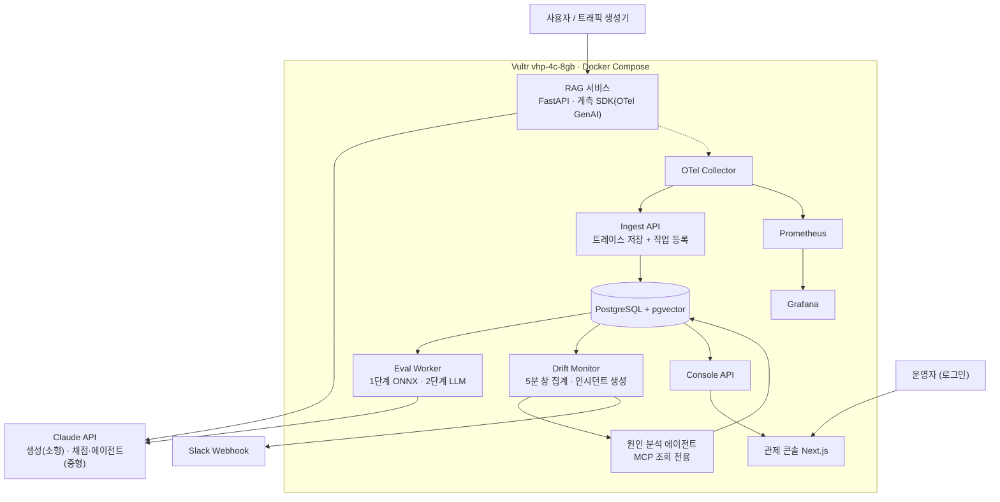

<div align="center">
  <h1>🔭 LLMOps 관측 플랫폼</h1>
  <p><strong>LLM 서비스의 모든 응답을 저비용으로 전수 감시하고, 품질을 떨어뜨린 변경을 근거와 함께 지목합니다</strong></p>
</div>

---

<a id="project-overview"></a>

## 프로젝트 소개

LLM 서비스의 품질 저하는 오류 없이 발생합니다. HTTP 200을 반환하고 지연도 정상인 상태에서 응답 내용의 품질만 떨어지는 문제를 기존 APM으로는 탐지할 수 없습니다.

이 플랫폼은 **경량 모델 전수 검사 + LLM 선별 검사의 2단 구조**로 감시 비용을 낮추고, 요청마다 프롬프트·모델·검색 설정 버전을 계측해 품질 저하와 원인 변경을 자동으로 연결합니다.

### 핵심 목표

| 목표 | 성공 기준 |
|---|---|
| 품질 저하 탐지 | 주입 시나리오 5종 모두 탐지, 오탐 횟수 보고 |
| 검사 비용 절감 | LLM 단독 전수 채점 대비 비용 절감률·정확도 유지율 측정 |
| 원인 변경 지목 | Top-1·Top-3 정확도가 규칙 기반 기준선보다 높음 |
| 성능 영향 최소화 | 계측 적용 전후 p95 응답 지연 차이 측정·보고 |

---

<a id="team"></a>

## 팀원 소개

| 담당 | 역할 |
|---|---|
| `AI-SVC` | 플랫폼 백엔드·인프라·에이전트·관제 콘솔 |
| `AI-MDL` | 탐지 모델 연구·평가 설계·실험 |

---

<a id="features"></a>

## 주요 기능

- **계측 SDK** — OTel GenAI 표준으로 모든 생성 요청에 프롬프트·모델·검색 설정 버전을 자동 기록
- **2단 검사 파이프라인** — 1단계 ONNX INT8 전수 탐지 + 2단계 LLM 선별 채점으로 비용–정확도 균형점 실험
- **드리프트 감지** — 5분 창 단위 품질 시계열을 감시해 이상 징후를 자동 탐지·알림
- **원인 분석 에이전트** — MCP 조회 전용 도구로 버전 이력을 탐색하고 원인 후보를 근거와 함께 제시
- **관제 콘솔** — 비용·지연 시계열, 인시던트 타임라인, 에이전트 조사 과정을 한 화면에서 확인

---

<a id="system-architecture"></a>

## 시스템 아키텍처



> 실선: 동기, 점선: 비동기. 검사 계층은 요청 경로 밖에서 동작합니다.

---

<a id="tech-stack"></a>

## 기술 스택

### Backend


### AI / Model


### Frontend


### Database


### Observability


### Infra · Deploy


---

<a id="project-structure"></a>

## 프로젝트 구조

```text
aisv-team17/
├── backend/              # Python 백엔드 전체 (AI-SVC)
│   └── src/
│       ├── sdk/          # OTel 계측 SDK
│       ├── rag/          # 감시 대상 RAG 서비스
│       ├── ingest/       # 트레이스 수신·저장 API
│       ├── worker/       # 비동기 검사 워커
│       ├── drift/        # 드리프트 판정·인시던트 생성
│       ├── agent/        # 원인 분석 에이전트
│       └── console/      # 관제 콘솔 백엔드 API
├── model/                # 탐지 모델 연구 (AI-MDL)
│   └── src/
│       ├── data/         # 데이터셋 전처리
│       ├── train/        # 학습 코드
│       ├── evaluate/     # 평가 스크립트
│       └── convert/      # ONNX 변환·양자화
├── frontend/             # Next.js 관제 콘솔 (AI-SVC)
├── configs/              # 버전 관리 원본 (프롬프트·모델·검색 설정)
├── infra/                # OTel Collector·Prometheus·Grafana 설정
├── docs/                 # 설계 문서·ADR·실험 프로토콜
├── docker-compose.yml
└── .env.example
```

---

<a id="developer-guide"></a>

## 개발자 안내

<details>
<summary><strong>로컬 실행</strong></summary>

### 요구 사항

- Python 3.12+, uv 0.4+
- Docker & Docker Compose 2.20+
- Node.js 20 LTS+

### 환경 변수 설정

```bash
cp .env.example .env
# .env에서 POSTGRES_PASSWORD, OPENAI_API_KEY 등 필수 값을 채웁니다
```

### 전체 스택 기동

```bash
docker compose -f docker-compose.yml -f docker-compose.override.yml up -d --build
```

### DB 마이그레이션

```bash
docker compose exec console alembic upgrade head
```

### 동작 확인

| 서비스 | 주소 |
|---|---|
| 관제 콘솔 | http://localhost:3000 |
| RAG API 문서 | http://localhost:8001/docs |
| Grafana | http://localhost:3001 |

</details>

---

<a id="related-docs"></a>

## 관련 문서

- [Git/GitHub 메뉴얼](CONTRIBUTING.md)
- [아키텍처 결정 기록 (ADR)](docs/adr/)
- [기능 요구사항 명세](docs/specs/SDD.md)
- [실험 프로토콜](docs/experiments/protocol.md)
- [운영 런북](docs/ops/runbook.md)