# 다이어그램 v1.0

> 최종 수정일: 2026-10-31

---

## 0. 작성 규칙

### 작성 규칙

- 다이어그램은 Mermaid로 작성한다. 흐름은 `sequenceDiagram`, 상태는 `stateDiagram-v2`, 판정·분기는 `flowchart`를 쓴다.
- **정상 흐름만 그리지 않는다.** 필수 다이어그램에는 실패·중복·경합 경로를 `alt`/`opt`로 함께 넣는다.
- 각 절의 체크박스는 다이어그램이 실제 구현과 검증 완료되었을 때 체크한다.
- 모든 스팬 오프셋·점수 방향·Enum 값은 `인터페이스 계약`을 기준으로 맞춘다.

---

## 1. 전체 시스템 구성도

> 작성: BOTH
> 
- [x]  기획서 4.1 다이어그램과 동기화 완료 여부 확인

### 1.1 전체 아키텍처

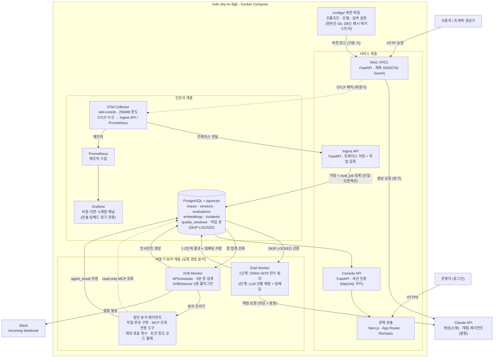

> 실선: 동기 호출 / 점선: 비동기·조회 전용.
품질 검사·드리프트 감지·에이전트는 모두 사용자 응답 경로 밖에서 비동기로 동작한다.
> 

---

## 2. 텔레메트리 수집 흐름

> 작성: AI-SVC
> 
- [ ]  OTLP 배치 전송 실패 시 SDK 버퍼링·재시도 경로 구현 확인
- [ ]  버전 해시 중복 등록 방지 로직 확인 (versions 테이블 upsert)

### 2.1 RAG 요청 → 수집 파이프라인 (sequenceDiagram)

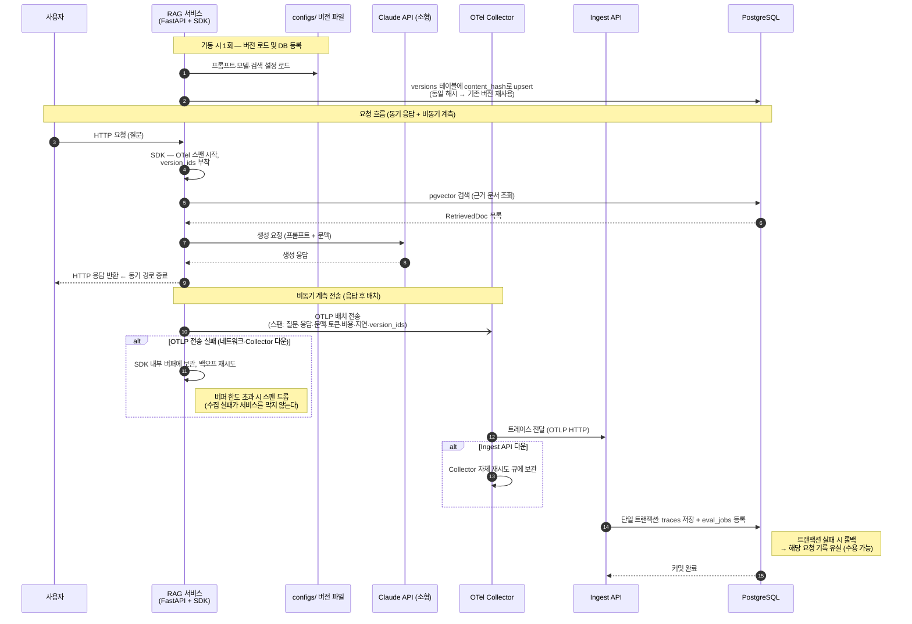

---

## 3. 2단 품질 검사 흐름

> 작성: BOTH
> 
- [ ]  BudgetExceededError 발생 시 1단계 유지·2단계 중단 처리 확인
- [ ]  SKIP LOCKED 선점 후 임대 시간 내 미완료 시 재선점 로직 확인 (policies.md)

### 3.1 Eval Worker — 검사 실행 흐름 (sequenceDiagram)

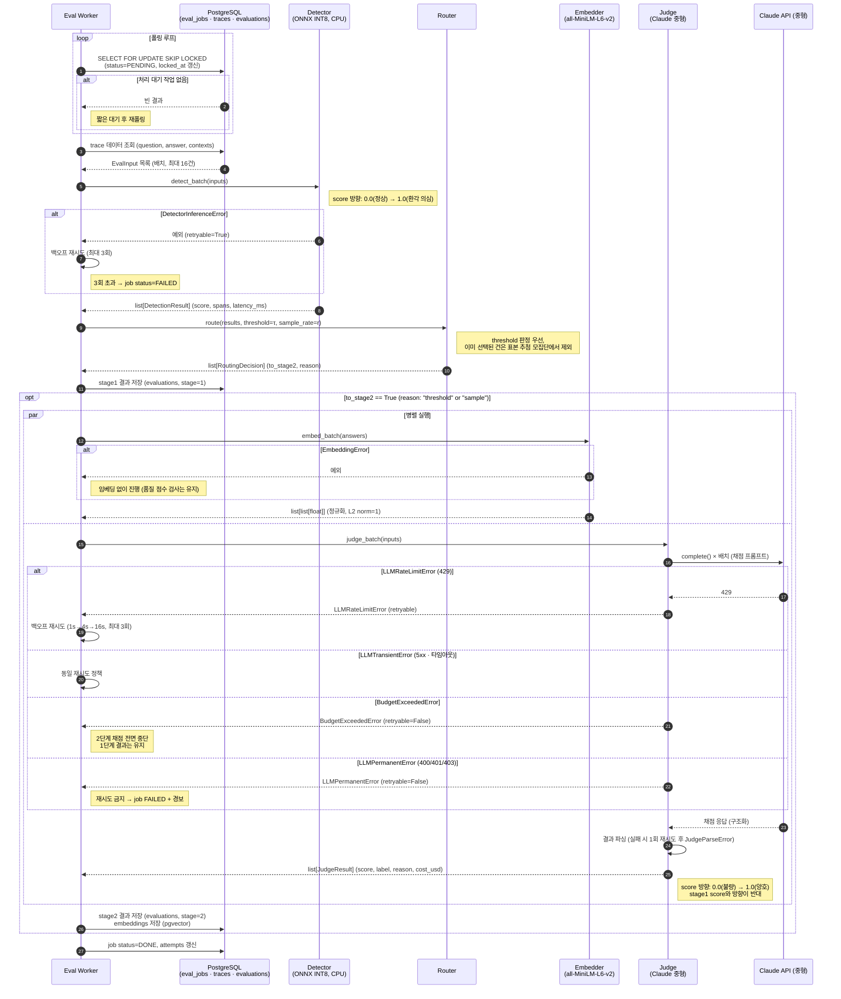

### 3.2 라우팅 판정 로직 (flowchart)

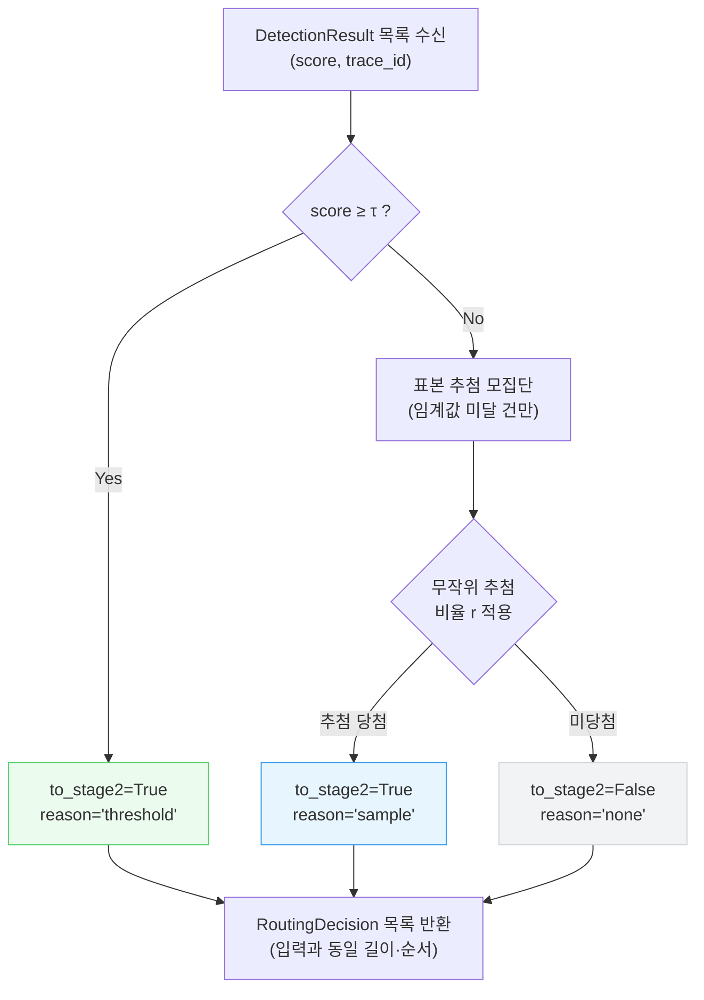

---

## 4. 드리프트 감지 및 알림 흐름

> 작성: BOTH
> 
- [ ]  쿨다운 중복 발송 억제 (dedup_key 기반) 구현 확인
- [ ]  표본 부족(sample_count < 30) 시 deferred 처리 확인
- [ ]  3종 판정기 중 일부 DriftInputError 발생 시 나머지 판정기 계속 실행 확인

### 4.1 Drift Monitor 주기 실행 (sequenceDiagram)

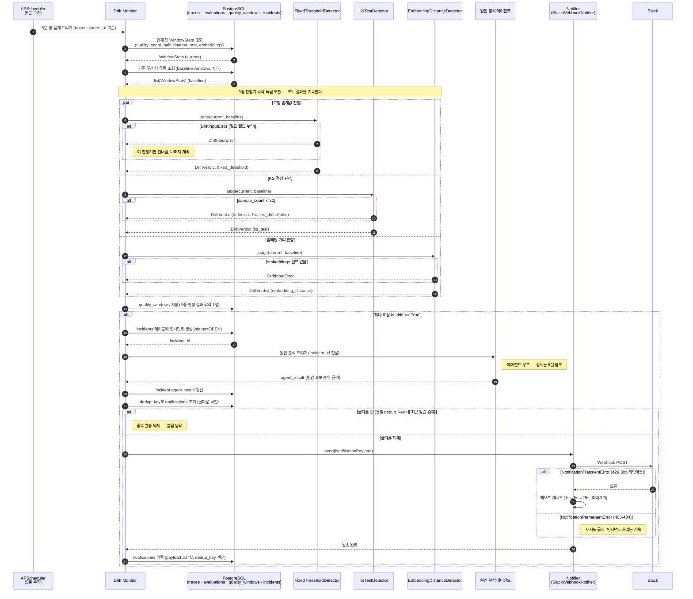

---

## 5. 원인 분석 에이전트 흐름

> 작성: AI-SVC
> 
- [ ]  최대 호출 횟수·토큰 한도 코드 통제 구현 확인 (ADR-007)
- [ ]  MCP 도구 — DB read-only 계정으로만 접근하는지 확인
- [ ]  에이전트 결론 미달 시 규칙 기반 대체(직전 변경 지목) 동작 확인

### 5.1 에이전트 루프 상세 (sequenceDiagram)

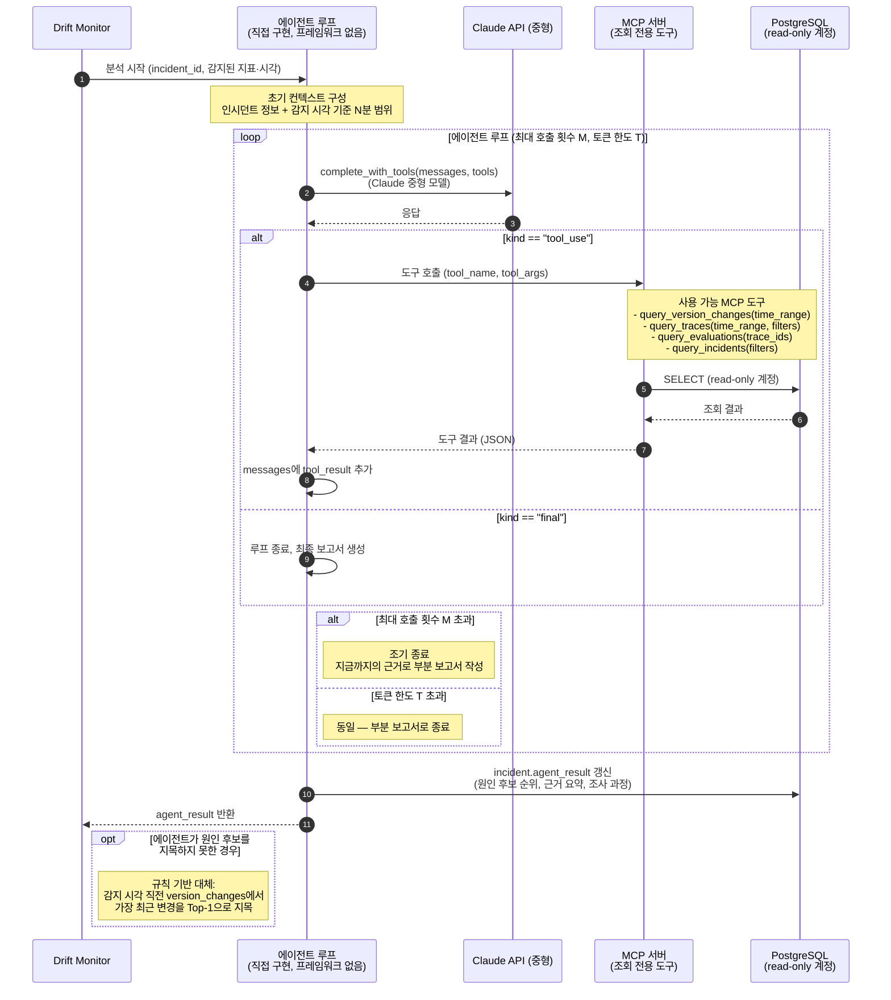

---

## 6. 관제 콘솔 화면 흐름

> 작성: AI-SVC (운영 화면) / AI-MDL (실험 화면)
> 
- [ ]  세션 인증(httpOnly 쿠키) — 로그인 만료 시 리다이렉트 동작 확인 (ADR-017)
- [ ]  Grafana 패널 임베드 — 읽기 전용 + 콘솔 로그인 후에만 노출 확인
- [ ]  A/B 비교 화면: 표본 수·유의성 함께 표시 여부 확인

### 6.1 화면 전환 흐름 (flowchart)

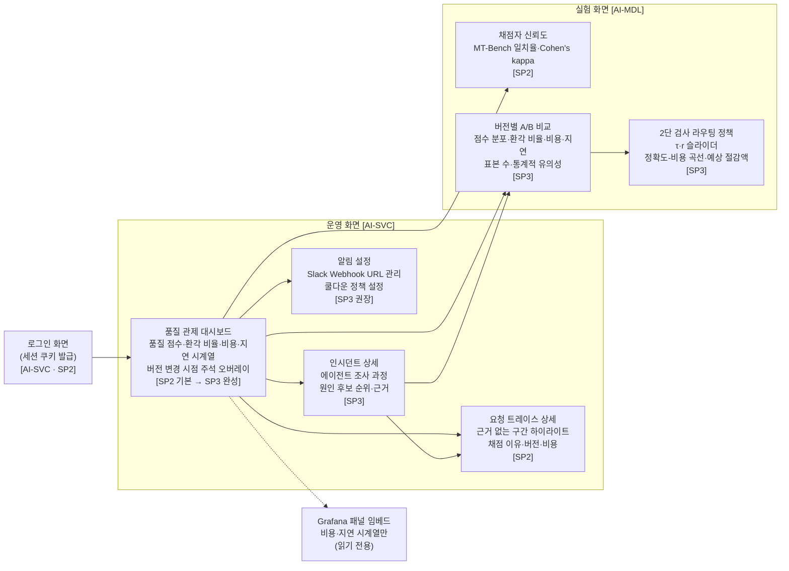

---

## 7. 배포 및 인프라 구성도

> 작성: AI-SVC
> 
- [ ]  GitHub Actions OIDC 인증 (AWS/Vultr) — 비밀값 없이 동작 확인 (ADR-020, ADR-021)
- [ ]  컨테이너별 mem_limit 설정 여부 확인 (ADR-014)
- [ ]  Secrets: 로컬 `.env` ↔ GitHub Secrets 2계층 분리 확인 (ADR-021)

### 7.1 CI/CD 파이프라인 (flowchart)

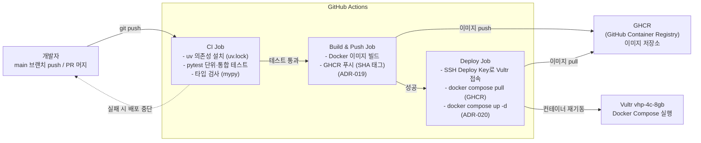

### 7.2 Docker Compose 컨테이너 구성 (flowchart)

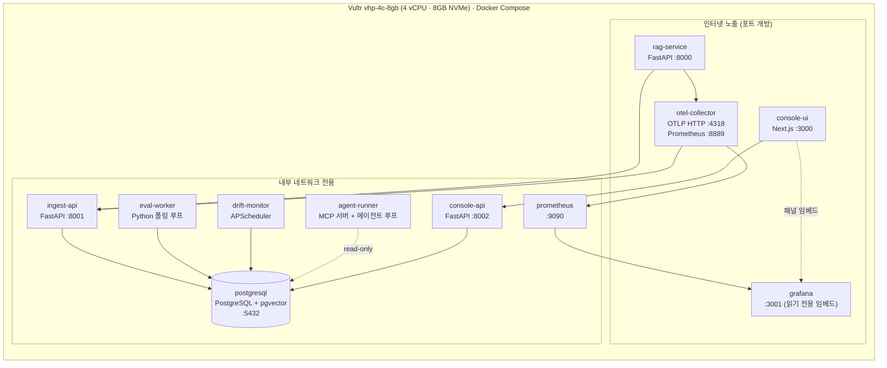

---

## 8. 인터페이스 계층 구조

> 작성: BOTH
> 
- [ ]  인터페이스 계약 v1.1의 Protocol 정의와 동기화 확인

### 8.1 인터페이스 ↔ 구현체 관계 (flowchart)

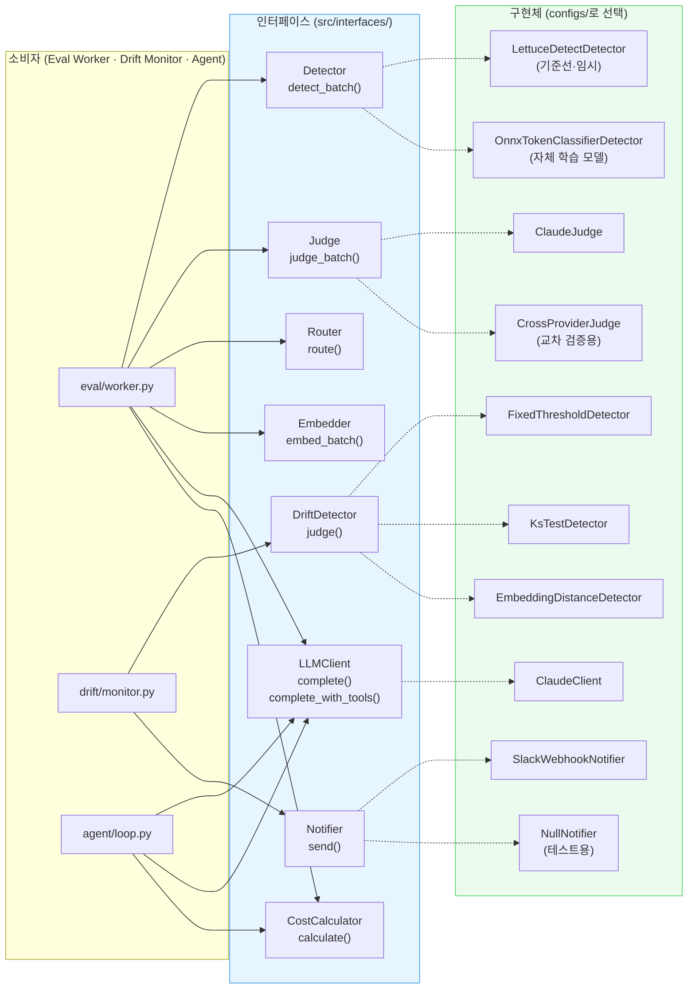

---

## 9. eval_job 상태 전이

> 작성: AI-SVC
> 
- [ ]  FAILED 상태에서 수동 재처리 흐름 확인 (policies.md)
- [ ]  임대 시간 초과 시 PENDING 재전환 로직 확인 (SKIP LOCKED 임대 만료)

### 9.1 eval_jobs 상태 머신 (stateDiagram-v2)

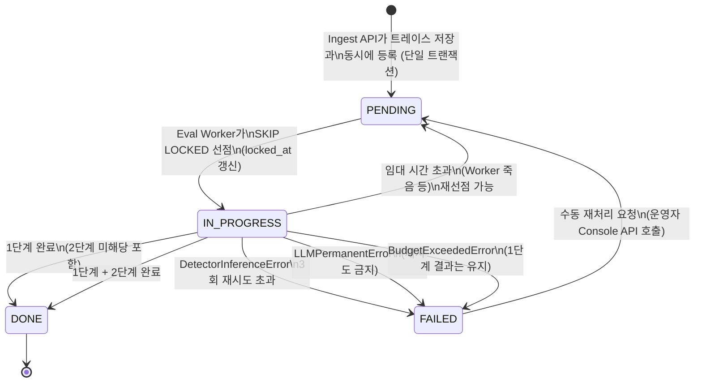

---

## 부록

### A. 서비스 간 종단 흐름

| 흐름 | 이어 붙일 절 | 상태 |
| --- | --- | --- |
| 요청 1건의 전체 생애: 진입 → 계측 → 수집 → 검사 → 결과 | 2.1 → 3.1 → 3.2 |  |
| 품질 저하 탐지 후 원인 지목 + 알림까지 | 4.1 → 5.1 |  |
| 운영자가 인시던트를 확인하고 트레이스까지 조회하는 흐름 | 4.1 → 6.1 |  |
| 버전 변경(configs/ 배포) 후 검사 결과가 갱신되는 흐름 | 7.1 → 2.1 → 3.1 |  |
| BudgetExceededError 발생 시 1단계 유지·전체 서비스 영향 흐름 | 3.1 (alt 분기) → 4.1 |  |
| 탐지 모델 교체 (LettuceDetect → 자체 ONNX 모델) | 8.1 → 3.1 |  |

---

end.