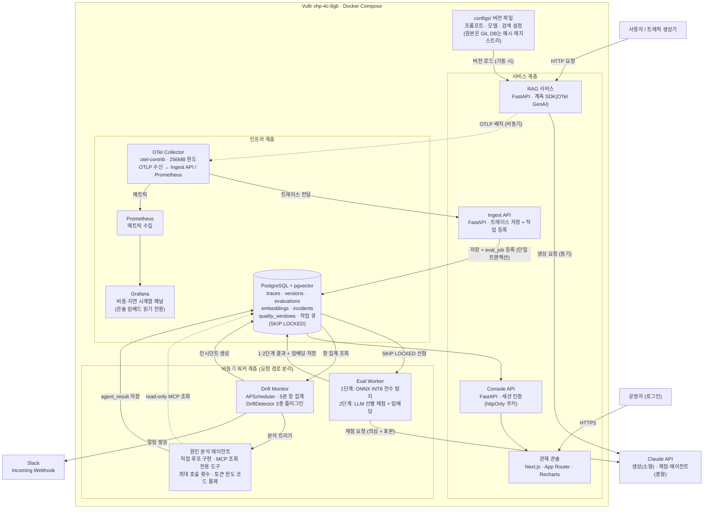

# 프로젝트 기획서 v1.1

## 0. 팀 정보

| 항목 | 내용 |
| --- | --- |
| 프로젝트명 | LLMOps (서비스명 미정) |
| 팀명 | AISV-Team17 |
| 최초 작성일 | 2026-10-25 |
| 최종 수정일 | 2026-10-31 |
| GitHub Repository | AISV-Team17/aisv-team17 (모노레포) |
| 서비스 사이트 | 미배포 — SP2 11주차 Vultr 퍼블릭 IP로 공개 예정 |
| 배포 방식 | GitHub Actions CD → GHCR → Vultr vhp-4c-8gb |
| API 문서 | FastAPI 자동 생성 Swagger UI (`/docs`) |

### 팀원 및 역할

| 담당 | 역할 | 담당 업무 |
| --- | --- | --- |
| `AI-SVC` | AI 서비스 | 플랫폼 백엔드·인프라·에이전트·운영 화면 |
| `AI-MDL` | AI 모델 | 탐지 모델 연구·평가 설계·실험 화면 |
| `BOTH` | 공통 | 서비스 언어·도메인 결정, 주입 시나리오 설계, 인터페이스 계약, 발표 분담 |

---

## 1. 프로젝트 개요

### 1.1 한 줄 소개

LLM 서비스의 **모든 응답을 저비용으로 전수 감시**하고, **품질을 떨어뜨린 변경을 근거와 함께 지목**하는 LLMOps 관측 플랫폼이다.

### 1.2 문제 정의

**LLM 서비스의 품질 저하는 오류 없이 발생한다.**

일반 웹 서비스의 장애는 5xx 오류·지연 급증처럼 수치로 드러나지만, LLM 서비스는 HTTP 200을 반환하고 지연도 정상인 상태에서 응답 내용의 품질만 떨어진다. 기존 APM(Application Performance Monitoring, 애플리케이션 성능 모니터링)으로는 이를 탐지할 수 없다.

공개된 사고 사례에서 공통된 특징은 세 가지였다.

| 사례 | 원인 | 시사점 |
| --- | --- | --- |
| Anthropic (2026.04, Claude Code) | 모델 가중치가 그대로인 상태에서 시스템 프롬프트·기본값·캐시의 **변경**이 품질을 저하시켰다. 변경마다 적용 시점과 대상 트래픽이 달라 내부 평가로 재현되지 않았다. | 품질 저하의 원인은 "변경"이며, **변경 단위 추적**이 필요하다. |
| OpenAI (2025.04) | 업데이트 후 아첨 경향이 나타났으나 오프라인 평가와 A/B 지표가 포착하지 못해 버전을 되돌렸다. | **운영 중 지속 감시**가 배포 전 평가보다 중요하다. |

**기존 방식의 한계:**

- **APM** — 응답 내용을 보지 않는다. "응답이 틀렸다"는 사실 자체를 신호로 만들 수 없다.
- **배포 전 평가** — 미리 정해 둔 질문 집합에서만 성립한다. 특정 트래픽·시점에만 나타나는 저하는 재현되지 않는다.
- **전수 LLM 채점** — 응답 1건당 생성 비용에 준하는 평가 비용이 들어, 대부분의 팀이 표본 검사에 머문다. (관측 도구 도입 89% vs. 평가 도입 52%, LangChain 설문 2025.11~12)

### 1.3 해결 방향

| 문제 | 해결 방향 |
| --- | --- |
| 오류 없는 품질 저하를 탐지하지 못한다 | 응답 내용 기반 품질 검사 + 품질 점수·임베딩 시계열 감시 |
| 전수 LLM 채점 비용이 지나치게 높다 | 경량 모델 전수 검사 + LLM 선별 검사의 2단 구조로 정확도–비용 균형점을 실험으로 제시 |
| 원인 변경을 찾는 데 오래 걸린다 | 요청마다 버전을 계측하고, 조회 전용 에이전트가 원인 후보를 근거와 함께 제시 |
| LLM 채점 결과를 그대로 믿기 어렵다 | 운영 적용 전에 사람 평가 데이터로 채점자 신뢰도를 사전 검증 |
| 관측이 서비스 성능을 해칠 수 있다 | 검사를 요청 경로에서 분리 (비동기 워커) |
| 탐지 모델 서빙에 GPU가 필요하면 비용 전제가 깨진다 | ONNX 변환·양자화로 CPU 추론 실현 |

### 1.4 목표

**공통:** LLM 서비스 운영 팀이 품질 저하를 사용자 신고보다 먼저 발견하고, 원인 변경을 근거와 함께 확인할 수 있게 한다.

| 목표 | 성공 기준 |
| --- | --- |
| 품질 저하 탐지 | 주입 시나리오 5종 모두 탐지, 정상 구간 오탐 횟수 보고 |
| 검사 비용 절감 | LLM 단독 전수 채점 대비 비용 절감률·정확도 유지율·누락률을 τ·r 격자에서 측정 |
| 원인 변경 지목 | 주입 변경 기준 Top-1·Top-3 정확도가 규칙 기반 기준선(직전 변경 지목)보다 높다 |
| 채점 신뢰도 | MT-Bench 사람 평가와의 일치율·Cohen's kappa 보고 |
| 탐지 모델 효율 | 최적화 전후 CPU p95 지연·모델 크기 감소폭, F1 손실폭 |
| 성능 영향 최소화 | 계측 적용 전후 p95 응답 지연 차이 측정·보고 |

### 1.5 기대 효과

| 관점 | 기대 효과 |
| --- | --- |
| 운영 | 품질 저하를 사용자 신고보다 먼저 발견하고, 원인 변경을 근거와 함께 확인하여 롤백 판단 시간을 단축한다. |
| 비용 | 경량 모델 전수 검사로 감시 비용을 낮춰, 예산이 적은 팀도 표본 검사가 아닌 전수 감시를 할 수 있다. |
| 표준·연구 | OTel GenAI 표준 기반으로 다른 관측 도구와 호환되고, 실험 결과와 주입 프레임워크가 재현 가능한 자료로 남는다. |
| 역량 | `AI-SVC`는 관측 파이프라인·모델 서빙·에이전트 실무 스택을, `AI-MDL`은 Transformer 미세조정·LLM 평가 설계 경험을 확보한다. |

---

## 2. 서비스 대상

### 2.1 타겟 사용자

**1차 타겟:** 전담 평가 인력이 없는 소규모 LLM 서비스 팀 (1~5인, 20~30대 백엔드·AI 개발자)

| 공통 상황 | 공통 니즈 |
| --- | --- |
| 프롬프트·모델·검색 설정을 주 단위로 바꾸며 운영한다. | 코드 몇 줄로 붙는 계측 |
| 품질 검증은 배포 전 수동 확인이나 소수 표본 검토에 의존한다. | 변경 직후 품질이 떨어지면 오는 알림 |
| 품질 저하를 사용자 문의로 알게 된다. | "어떤 변경이 원인인지"에 대한 근거 |
| 전담 평가 인력·예산·MLOps 인프라가 없다. | 판정 근거를 사람이 확인할 수 있을 것 |

**2차 타겟:** 사내 챗봇 운영 담당자 (문서·청크 설정 변경이 잦고 환각에 민감), LLM 평가를 연구하는 학생·연구자 (재현 가능한 실험 환경 필요)

### 2.2 사용자 시나리오

| 시나리오 | 사용자 행동 | 기대 결과 |
| --- | --- | --- |
| 최초 연동 | 계측 SDK를 설치하고 생성 함수에 데코레이터를 추가한다. | 수 분 내에 대시보드에 요청·토큰·비용·지연이 쌓이기 시작한다. |
| 변경 후 감시 | 시스템 프롬프트를 v1.3으로 배포 후 평소처럼 일한다. | 30분 뒤 환각 비율 상승이 감지되어 Slack 알림이 온다. |
| 원인 확인 | 알림의 링크로 인시던트 상세를 연다. | 품질 타임라인 위에 변경 이력이 겹쳐 보이고, 원인 후보 순위와 에이전트의 조사 과정이 보인다. |
| 개별 응답 검증 | 근거 응답의 트레이스 상세를 연다. | 근거 없는 구간이 강조되고 채점 이유·버전·비용이 보인다. |
| 비용 조절 | 라우팅 정책 화면에서 임계값 τ와 표본 비율 r을 조정한다. | 정확도–비용 곡선과 예상 절감액이 함께 바뀐다. |
| 버전 비교 | A/B 비교 화면에서 두 버전을 비교한다. | 점수 분포·환각 비율·비용·지연 차이와 표본 수·유의성이 보인다. |

### 2.3 경쟁 서비스 요약

| 서비스 | 핵심 한계 |
| --- | --- |
| Langfuse | 품질 저하와 변경을 인과로 연결하는 분석은 사람이 직접 한다. |
| Arize Phoenix | 평가 비용 구조(무엇을 얼마나 채점할지)에 대한 정책·실험 기능이 없다. |
| Braintrust | 배포 전 실험에 무게가 실려 운영 중 실시간 감시는 약하다. |
| Datadog LLM Obs. | 폐쇄형이라 검사 비용 구조를 검증·조정할 수 없고 소규모 팀에는 가격 부담이 크다. |

**공통 한계:** 전수 검사 비용 구조를 사용자가 통제할 수 있게 열어 둔 도구가 없고, 품질 저하와 변경 이력을 자동으로 연결해 원인 후보를 근거와 함께 제시하는 기능이 없다.

**차별화 포인트:**

1. **2단 구조의 비용·정확도 실험 공개** — 기능의 유무가 아니라 "같은 정확도를 얼마나 싸게 얻는가"를 수치로 제시한다.
2. **원인 변경 추적** — 에이전트가 변경 이력·트레이스·채점 결과를 근거로 원인 후보를 순위와 함께 낸다.
3. **검증 절차 공개** — 채점자 신뢰도를 사전 검증하고, 판정 근거를 화면에서 사람이 직접 확인할 수 있다.

---

## 3. 서비스

### 3.1 핵심 기능 (사용 흐름 순서)

| # | 기능 | 담당 | 시점 |
| --- | --- | --- | --- |
| 1 | **버전 단위 계측** — 데코레이터로 질문·응답·검색 문맥·토큰·비용·지연과 프롬프트·모델·검색 설정 버전을 OTel GenAI 표준 속성으로 수집한다. | `AI-SVC` | SP2 |
| 2 | **2단 품질 검사** — 경량 환각 탐지 모델(ONNX·INT8·CPU)이 전수 검사하고, 의심 응답과 무작위 표본만 LLM 채점자가 정밀 평가한다. | `BOTH` | SP2 |
| 3 | **품질 드리프트 감지·알림** — 품질 점수·응답 임베딩 분포 변화를 감지하면 인시던트를 생성하고 Slack으로 알린다. | `BOTH` | SP3 |
| 4 | **원인 변경 분석** — 조회 전용 에이전트가 변경 이력·트레이스·채점 결과를 조사하여 원인 후보를 순위·근거와 함께 제시한다. | `BOTH` | SP3 |

### 3.2 화면 구성

| 화면 | 구분 | 담당 | 시점 |
| --- | --- | --- | --- |
| 로그인 | 운영 | `AI-SVC` | SP2 |
| 품질 관제 대시보드 | 운영 | `AI-SVC` | SP2 기본 → SP3 완성 |
| 요청 트레이스 상세 | 운영 | `AI-SVC` | SP2 |
| 채점자 신뢰도 | 실험 | `AI-MDL` | SP2 |
| 인시던트 상세 | 운영 | `AI-SVC` | SP3 |
| 버전별 A/B 비교 | 실험 | `AI-MDL` | SP3 |
| 2단 검사 라우팅 정책 | 실험 | `AI-MDL` | SP3 |
| 알림 설정 | 운영 | `AI-SVC` | SP3 (권장) |

**디자인 방향성:**

- 점수만이 아니라 판정 근거(근거 없는 구간, 채점 이유, 에이전트 조사 과정)를 함께 보여 준다.
- 시계열 그래프 위에 버전 변경 시점을 주석으로 올려 "언제 떨어졌는가"와 "무엇이 바뀌었는가"를 한 화면에서 잇는다.
- A/B 비교에는 표본 수와 통계적 유의성을 함께 표시해 불확실성을 숨기지 않는다.

### 3.3 성공 기준

| 구분 | 기준 |
| --- | --- |
| 연동 | 계측 SDK 적용 후 요청이 콘솔에 보인다. |
| 성능 영향 | 계측이 응답 지연을 눈에 띄게 늘리지 않는다. |
| 검사 | 모든 응답이 1단계 검사를 거치고, 라우팅 사유가 기록된다. |
| 탐지 | 주입한 품질 저하를 자동으로 감지한다. |
| 원인 | 원인 변경을 상위 후보로 지목한다. |
| 신뢰 | 판정 근거를 사람이 확인할 수 있다. |
| 운영 | 배포된 서비스가 시연 중 멈추지 않는다. |

---

## 4. 시스템 설계

### 4.1 시스템 아키텍처

전체 시스템 구성도와 각 컴포넌트의 역할을 기술한다.

> 실선: 동기 호출, 점선: 비동기 전송·조회 전용. 품질 검사 계층은 사용자 응답 경로 밖에서 비동기로 동작한다.
> 

**핵심 설계 원칙 두 가지:**

- 계측과 검사를 요청 경로에서 분리하여 감시가 서비스를 느리게 하거나 멈추지 않게 한다.
- 모든 기록에 버전을 붙여 품질 저하를 변경과 이어 붙일 수 있게 한다.

> 상세 설계 판단 근거(컴포넌트별 대안 비교, 선택 이유) → `docs/adr/`
> 

### 4.2 기술 스택

| 구분 | 기술 | 선택 이유 요약 |
| --- | --- | --- |
| 프론트엔드 | Next.js (App Router, TypeScript), Recharts | 환각 하이라이트·인시던트 타임라인·조사 과정은 범용 대시보드 도구로 표현 불가 |
| 백엔드 | Python 3.12, FastAPI, uv | ONNX·Transformers·OTel·MCP 생태계가 Python 우선, 모델 파트 코드 직접 연동 가능 |
| AI/LLM | Claude API (생성: 소형 / 채점·에이전트: 중형), MCP | 기관 지원 키로 비용 통제, 모델 등급 분리로 자기 선호 편향 감소 |
| 모델 학습·서빙 | PyTorch, Hugging Face Transformers·Optimum, ONNX Runtime | 학습 → ONNX → INT8 경로로 CPU 서빙. F1 손실 폭은 SP2 실험 후 확정한다. |
| 임베딩 | sentence-transformers (all-MiniLM-L6-v2, 384차원) | CPU 구동, 드리프트 감지에 분포 변화 감지력이 중요 |
| 데이터베이스 | PostgreSQL + pgvector | 관계형·벡터·작업 큐(`SKIP LOCKED`)를 단일 엔진으로 처리 |
| 관측 | OpenTelemetry (GenAI Semantic Conventions), Prometheus, Grafana | 표준 속성으로 도구 독립, Collector가 OTLP 수신 담당 |
| 알림 | Slack Incoming Webhook | 무료 플랜, 실무 관제 표준, `Notifier` 인터페이스로 교체 가능 |
| 인프라 | Vultr vhp-4c-8gb (4vCPU, 8GB NVMe), Docker Compose, GitHub Actions | 선불 결제 지원, 스택 전체 메모리 합이 4GiB 초과, 필요 기간만 가동으로 비용 절감 |

> 상세 기술 선택 근거(대안 비교, ADR) → `docs/adr/`
> 

---

## 5. 기능 범위 정의

### 5.1 MVP (SP2 필수)

| 기능 | 필수 이유 |
| --- | --- |
| 계측 SDK + 버전 이력 | 버전 없는 기록은 원인 추적의 전제를 무너뜨린다. |
| 1단계 전수 검사 | "전수"가 이 서비스의 차별점 자체다. 자체 모델 학습 완료 전에는 공개 모델(LettuceDetect)로 먼저 구동하여 파이프라인을 SP2 일정 안에 완성한다. |
| 2단계 선별 채점 (임계값 + 무작위 표본) | 표본이 없으면 누락률을 셀 수 없어 2단 구조를 증명할 수 없다. |
| 대시보드·트레이스 상세·로그인 | 판정 근거를 사람이 확인하는 최소 경로다. |
| 수동 주입 1개 | "변경 → 품질 하락"이 실제로 보인다는 것을 SP2에서 증명한다. |

### 5.2 확장 (SP3 필수 / 권장)

- 드리프트 자동 감지·Slack 알림 (SP3 필수)
- 원인 분석 에이전트·MCP 도구·인시던트 상세 (SP3 필수, 지연 시 규칙 기반 대체)
- 시나리오 5종 주입 실험 (SP3 필수)
- A/B 비교·라우팅 정책 화면 (SP3)
- 알림 설정 화면 (SP3 권장)

### 5.3 범위 외 (의도적 제외)

| 제외 기능 | 제외 이유 |
| --- | --- |
| 회원가입·다중 테넌트·권한 등급 | 핵심 문제와 직접 연결되지 않는다. 시드 계정 로그인으로 공개 노출만 막는다. |
| 자동 롤백·자동 조치 | 에이전트가 쓰기 권한을 가지면 오판의 영향이 서비스로 번진다. 조사·제시까지만, 조치는 사람이 결정한다. |
| 프롬프트 편집·배포 기능 | 버전의 원본은 Git이다. 콘솔 편집은 변경 사유가 커밋에 남지 않아 추적 전제가 깨진다. |
| 실시간 스트리밍 응답 검사 | 검사 목적이 사후 관측이고, 요청 경로 분리가 설계 전제다. |
| 모바일 대응 | 운영 관제 화면이라 데스크톱 사용이 전제다. |

---

## 6. 개발 계획

### 6.1 스프린트 일정

| 스프린트 | 기간 | `AI-SVC` | `AI-MDL` | 완료 기준 |
| --- | --- | --- | --- | --- |
| **SP1** | 7~8주 | 기획서·ADR·아키텍처·DB 스키마 초안, 주입 시나리오 정의 | 데이터셋 확보·EDA, 평가 지표 확정, 와이어프레임 | 기획서 발표 완료 |
| **SP2 전반** | 9~10주 | 모노레포·CI·Compose·CODEOWNERS, 버전 관리, RAG 서비스, 계측 SDK, Collector·Ingest·DB, 비동기 워커 | RAGTruth EDA, 학습 파이프라인, 채점자 신뢰도 1차 | 요청 1건이 계측→수집→저장→1·2단 검사→대시보드까지 끊기지 않고 도달 |
| **SP2 후반** | 11~12주 | AWS 배포(Terraform), 수동 주입 1개, 운영 화면, 2단 구조 1차 실험 | 탐지 모델 1차 학습·분석, 채점자 신뢰도 화면 | 수동 주입 1개로 품질 그래프 하락 시연. 2단 구조 1차 수치 제시 |
| **SP3 전반** | 13주 | ONNX·양자화 최적화, 라우팅 격자 실험, 드리프트 감지 연동, Slack 알림 | 드리프트 3방식·시간 창 비교 실험, 시나리오 5종 실험 | 주입 후 사람 개입 없이 알림 도달 |
| **SP3 후반** | 14~15주 | 원인 분석 에이전트·MCP, 인시던트 상세 | 원인 탐지 평가, A/B 비교·라우팅 정책 화면, 논문 초고 | 주입→하락→알림→원인 제시 한 흐름 시연 |

### 6.2 릴리즈 이력

| 시점 | 내용 |
| --- | --- |
| 2026-10-21 | SP1 — 기획서 발표 |
| 2026-11-18 | SP2 — 수집·2단 검사·대시보드 + 수동 주입 데모 (예정) |
| 2026-11-24 | 학술제 출품 (예정) |
| 2026-12-09 | SP3 — 드리프트 감지·원인 분석·관제 콘솔 완성 데모 (예정) |

### 6.3 예산

> 환율 ₩1,400/$ 가정, 종량제 예상 사용량 기준. LLM API는 용도별 상세 산정에 1.3배 여유를 두었다.
> 

| 구분 | 내역 | 예상 비용 |
| --- | --- | --- |
| LLM API | Claude API 용도별 산정 (RAG 생성·채점·에이전트·디버깅) × 1.3배 | 약 $200 |
| 교차 검증 | 타 제공자 채점자로 2단계 채점 표본 100~200건 재채점 | 약 $5 이내 |
| Vultr | vhp-4c-8gb 약 300시간 (Seoul icn) | 약 $20 |
| GPU | Colab Pay As You Go  | $0~20 |
| **합계** |  | **약 $225~250** |

### 6.4 리스크 및 대응

| 리스크 | 대응 |
| --- | --- |
| 구성 요소 많아 일정 지연 | 필수/확장 범위 분리, 1단계는 공개 모델(LettuceDetect)로 우선 구동, 인터페이스 선합의(10/28)로 병렬 개발 |
| 자체 학습 모델이 기준선 미달 | 개선 축을 추론 효율(크기·지연)로 설정. 정확도–효율 곡선으로 운영 비용 관점 기여 제시. 2단 구조 분석은 모델 성능과 독립적으로 성립한다. |
| GPU 확보·학습 시간 부족 | 무료 Colab·Kaggle → 교내 GPU → Colab 유료 순으로 조달. 학습 전에는 공개 모델로 파이프라인 먼저 완성 |
| 단일 서버 메모리 부족 | 컨테이너별 `mem_limit`, 탐지 모델 양자화, 소형 임베딩 모델, 부하 시 2단계 Batch 처리 |
| LLM 비용 초과·에이전트 무한 반복 | 지출 한도, 에이전트 호출·토큰 상한, Batch API 우선 |
| 채점자 편향 | 신뢰도 사전 검증, 순서 교환 재채점, 생성·채점 모델 등급 분리, 타 제공자 표본 교차 검증 |
| AI 생성 코드 이해도 부족 | PR마다 설계 의도 요약 필수, 핵심 경로는 상대 파트 승인 필수 |
| 2인 팀 인력 공백 | 인터페이스 계약으로 더미 구현 가능, CODEOWNERS로 핵심 경로 양쪽 숙지 |

---

## 7. 참고 자료

| 구분 | 자료 | 활용 |
| --- | --- | --- |
| 사고 사례 | Anthropic, Claude Code 포스트모템 (2026.04) | 변경 단위 추적 필요성의 직접 근거 |
| 탐지 모델 | LettuceDetect (KR Labs, 2025) | 1단계 기준선 겸 임시 모델 (ADR-027). 자체 미세조정 인코더와 정확도–효율 곡선으로 비교한다. |
| 평가 방법론 | Judging LLM-as-a-Judge, Zheng et al. (NeurIPS 2023) | 채점자 신뢰도 검증 방법론 |
| 계측 표준 | OTel GenAI Semantic Conventions | 계측 속성 설계 기준 |
| 설문 | LangChain, State of Agent Engineering (2025.11~12) | 관측 89% vs. 평가 52% 격차의 근거 |
| 데이터 | RAGTruth (MIT), MT-Bench (CC-BY-4.0), MS MARCO | 학습·채점자 검증·실험 질문 집합 |
| 레퍼런스 서비스 | Langfuse, Arize Phoenix, Braintrust, Sentry | 화면 구성·수집 구조 참고 |

---

end.