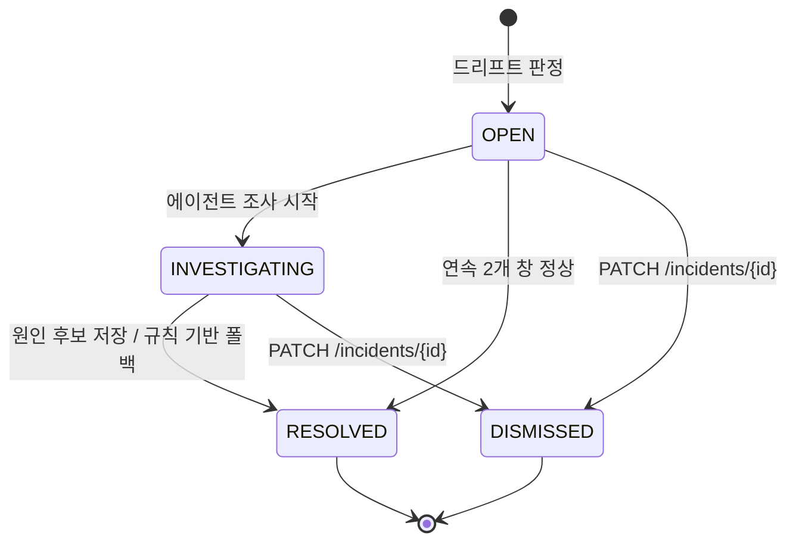

# API 명세서

> **최종 수정**: 2026-10-26

---

## 0. 공통 규약

### 0.1 기본 규칙

| 항목 | 값 |
| --- | --- |
| Base URL | Console API `/api/v1` · Ingest API `/internal/v1` (내부 네트워크 전용) |
| 인증 방식 | **세션 쿠키**(`session=<token>`, httpOnly·Secure·SameSite=Lax). 서버가 `sessions` 테이블에서 직접 검증한다. **JWT·Bearer 토큰을 쓰지 않는다**(ADR-017) |
| 요청 추적 ID | 서버가 요청마다 `X-Request-Id`를 생성하여 응답 헤더에 포함한다. 500 응답의 서버 로그와 대조하는 유일한 수단이다 |
| Content-Type | `application/json; charset=UTF-8` |
| 경로 규칙 | 리소스는 영문 소문자 복수형, 여러 단어는 `kebab-case` (`/routing-policy`, `/judge-reliability`) |
| 날짜·시각 | **UTC 기준 ISO 8601**(`2026-11-18T09:15:30Z`). DB는 `TIMESTAMPTZ`, 표시 변환은 프론트엔드가 한다(erd.md 1장) |
| 페이지네이션 | `?page=0&size=20&sort=field,desc` (`page` 0부터, `size` 기본 20·최대 100) |
| 검색 파라미터 | 검색어는 `keyword`, 기간 필터는 `from`·`to`(ISO 8601), 그 외는 의미가 드러나는 이름 |
| JSON 네이밍 | `camelCase` (DB는 `snake_case` — 변환은 서버가 한다) |
| 버전 정책 | 호환되지 않는 변경이 있을 때만 새 버전 추가. SP3 종료까지는 `v1` 고정 |
| CORS | **설정하지 않는다.** 콘솔과 API가 같은 출처에 배포되므로 교차 출처 요청이 발생하지 않는다(ADR-018) |

### 0.2 식별자(ID) 규칙

| 항목 | 규칙 |
| --- | --- |
| 생성 방식 | 외부 노출 리소스는 **UUID v4**(`incidentId`, `runId`, `userId`), 트레이스는 **OpenTelemetry trace id**(hex 32자리), 내부 리소스는 **BIGINT 시퀀스** |
| 타입 | UUID·trace id는 `string`, BIGINT 계열은 `number` |
| 외부 노출 | `traceId`·`incidentId`·`runId`는 응답에 노출한다. `versionId`·`changeId`·`windowId`는 숫자를 그대로 노출하되 **로그인 뒤에서만 접근 가능**하므로 순번 노출 위험을 허용한다. `traces.id`(내부 PK)·`sessions.id`는 **노출하지 않는다** |
| trace id 포맷 | 소문자 hex 32자리 (`^[0-9a-f]{32}$`) |
| 시나리오 ID | `SCN-{3자리 숫자}` (예: `SCN-001`). 파일명·API 파라미터·`injection_runs.scenario_id`가 모두 동일한 문자열을 쓴다 |

### 0.3 공통 요청 헤더

| 헤더 | 필수 | 설명 |
| --- | --- | --- |
| `Cookie: session=<token>` | 인증 필요 API | 로그인 시 서버가 발급. 클라이언트가 직접 설정하지 않는다 |
| `Idempotency-Key` | 해당 API | UUID v4. 중복 처리 방지. 유효 시간 60초. 현재는 `POST /injections`에만 적용 |
| `X-Client-Channel` | 선택 | `WEB`만 사용 |
| `X-Ingest-Source` | Ingest API 필수 | `collector` 고정. 내부 호출 식별용 |

```json
// 단건 조회 성공
{
  "success": true,
  "message": null,
  "data": {}
}

// 작업 성공 
{
  "success": true,
  "message": "{완료 안내}",
  "data": {}
}

// 실패
{
  "success": false,
  "error": {
    "code": "ERROR_CODE",
    "message": "{사용자 메시지}",
    "details": []
  }
}

// 검증 실패
{
  "success": false,
  "error": {
    "code": "INVALID_REQUEST",
    "message": "입력값을 확인해 주세요.",
    "details": [
      { "field": "threshold", "reason": "0.0 이상 1.0 이하여야 합니다." }
    ]
  }
}
```

**페이징 응답 표준** 

```json
{
  "content": [],
  "page": 0,
  "size": 20,
  "totalElements": 0,
  "hasNext": false
}
```

**컨트롤러 응답 규약** 

| 상황 | HTTP Status | 비고 |
| --- | --- | --- |
| 단건 조회 성공 | `200` | `data`에 도메인 객체 |
| 생성 성공 | `201` | `data`에 생성된 리소스 |
| 수정 성공 | `200` | `data`에 변경된 리소스 |
| 삭제 성공 | `204` | 응답 바디 없음 — 현재 삭제 엔드포인트는 없다 |
| 비동기 수락 | `202` | `data`에 진행 조회용 식별자 |
| 클라이언트 오류 | `400` `401` `403` `404` `409` `422` `429` | `success: false` |
| 서버·외부 오류 | `500` `502` `503` | `success: false` |

에러 응답에 내부 예외 메시지·SQL을 노출하지 않는다. 트레이스 본문에 사용자 데이터가 섞여 있을 수 있기 때문이다(policies.md 6.3).

### 0.5 에러 코드 표

| 에러 코드 | HTTP Status | 설명 |
| --- | --- | --- |
| `INVALID_REQUEST` | 400 | 입력 검증 실패 |
| `INVALID_TIME_RANGE` | 400 | `from > to`이거나 조회 기간 90일 초과 |
| `UNAUTHORIZED` | 401 | 세션 쿠키 없음 또는 검증 실패 |
| `SESSION_EXPIRED` | 401 | 세션 만료 → 프론트는 로그인 화면으로 이동 |
| `SESSION_REVOKED` | 401 | 강제 로그아웃된 세션 |
| `FORBIDDEN` | 403 | 인증됐으나 접근 불가 — 내부 전용 경로를 외부에서 호출 |
| `NOT_FOUND` | 404 | 리소스 없음 |
| `TRACE_NOT_FOUND` | 404 | 해당 `traceId`의 트레이스 없음 |
| `INCIDENT_NOT_FOUND` | 404 | 해당 `incidentId`의 인시던트 없음 |
| `VERSION_NOT_FOUND` | 404 | 해당 `versionId`의 버전 없음 |
| `CONFLICT` | 409 | 상태 충돌 |
| `INCIDENT_ALREADY_CLOSED` | 409 | 이미 `RESOLVED`·`DISMISSED`인 인시던트 상태 변경 시도 |
| `INJECTION_ALREADY_RUNNING` | 409 | 이미 실행 중인 주입 실험이 있음 |
| `DUPLICATE_TRACE` | 409 | 이미 수집된 `traceId` (Ingest, 멱등 처리) |
| `UNPROCESSABLE` | 422 | 처리 불가 입력 |
| `INVALID_ROUTING_POLICY` | 422 | τ·r이 0.0~1.0 범위를 벗어남 |
| `SCENARIO_NOT_FOUND` | 422 | 요청한 시나리오 정의 파일 없음 |
| `LOGIN_ATTEMPTS_EXCEEDED` | 429 | 로그인 실패 5회 → 10분 잠금 (policies.md 1.1) |
| `RATE_LIMITED` | 429 | 요청 한도 초과 (`Retry-After` 헤더 전달) |
| `INTERNAL_ERROR` | 500 | 서버 내부 오류 |
| `EXTERNAL_API_ERROR` | 502 | 외부 API 호출 실패 (LLM·Slack) |
| `EXTERNAL_API_UNAVAILABLE` | 503 | 외부 API 다운·타임아웃 |
| `BUDGET_EXCEEDED` | 503 | LLM 지출 한도 도달 — 2단계 채점 중단 상태 |

신규 엔드포인트 추가 시 이 표와 0.7 권한 매트릭스를 함께 갱신한다.

### 0.6 상태값 요약

API 응답에 노출되는 상태값이다. erd.md 8장 코드값과 문자열이 일치한다.

| 도메인(테이블) | 컬럼 | 상태값 | 설명 |
| --- | --- | --- | --- |
| `traces` | `status` | `OK` / `ERROR` | 응답 생성 성공 여부 |
| `evaluations` | `routedReason` | `threshold` / `sample` / `none` | 2단계 전달 사유 |
| `evaluations` | `label` | `SUPPORTED` / `HALLUCINATED` / `UNVERIFIABLE` | 채점 라벨 |
| `incidents` | `status` | `OPEN` / `INVESTIGATING` / `RESOLVED` / `DISMISSED` | 인시던트 진행 상태 |
| `incidents` | `metric` | `quality_score` / `hallucination_rate` / `embedding_distance` | 감지 지표 |
| `quality_windows` | `detectorName` | `fixed_threshold` / `ks_test` / `embedding_distance` | 드리프트 판정기. interfaces.md `DriftDetectorName` Enum 값 |
| `version_changes` | `source` | `deploy` / `injection` / `console` | 변경 출처 |
| `versions` | `kind` | `prompt` / `model` / `retrieval` / `judge_prompt` / `routing` / `pricing` | 버전 종류 |
| `injection_runs` | `status` | `RUNNING` / `COMPLETED` / `ABORTED` | 실험 회차 상태 |
| `injection_runs` | `mode` | `experiment` / `demo` | 실험용·시연용 구분 |
| `notifications` | `status` | `PENDING` / `SENT` / `FAILED` | 알림 발송 상태 |

### 0.7 권한 매트릭스

| API 그룹 | `GUEST` | `OPERATOR` | 내부(`COLLECTOR`·`WORKER`) |
| --- | --- | --- | --- |
| 1. 인증 (`/auth/login`) | ✅ | ✅ | — |
| 1. 인증 (`/auth/logout`, `/auth/me`) | ❌ 401 | ✅ | — |
| 2. 품질 지표 | ❌ 401 | ✅ 조회 | — |
| 3. 트레이스 | ❌ 401 | ✅ 조회 | — |
| 4. 버전·비교 | ❌ 401 | ✅ 조회 | — |
| 5. 인시던트 조회 | ❌ 401 | ✅ 조회 | — |
| 5. 인시던트 상태 변경 | ❌ 401 | ✅ **쓰기** | — |
| 6. 라우팅 정책 조회 | ❌ 401 | ✅ 조회 | — |
| 6. 라우팅 정책 변경 | ❌ 401 | ✅ **쓰기** → 변경 이력 기록 | — |
| 7. 알림 설정 | ❌ 401 | ✅ **쓰기** → 변경 이력 기록 | — |
| 8. 실험 지표 | ❌ 401 | ✅ 조회 | — |
| 9. 주입 실험 조회 | ❌ 401 | ✅ 조회 | — |
| 9. 주입 실험 실행 | ❌ 401 | ✅ **쓰기** | — |
| 10. 수집 (Ingest) | 🚫 네트워크 차단 | 🚫 네트워크 차단 | ✅ |
| 11. MCP 도구 | — | — | ✅ **조회 전용**(`AGENT`, DB read-only) |
| `/health` | ✅ | ✅ | ✅ |

- `OPERATOR`의 쓰기 행위는 `version_changes`에 `source='console'`로 기록된다(ADR-005).
- Ingest API는 Docker 내부 네트워크에만 바인드한다. 인증이 아니라 **네트워크 격리**로 보호한다(policies.md 1.5).
- `AGENT`의 조회 전용 제한은 **DB 계정 권한**으로 강제한다(ADR-007).

### 0.8 Rate Limit 정책

| 대상 API | 제한 기준 | 윈도우 | 초과 시 응답 |
| --- | --- | --- | --- |
| `POST /auth/login` | 아이디+IP 조합 **5회 실패** | 10분 | `429 LOGIN_ATTEMPTS_EXCEEDED` + `Retry-After: 600` |
| `POST /injections` | **동시 1건** | — | `409 INJECTION_ALREADY_RUNNING` |
| `POST /notification-settings/preview` | 사용자당 **20회** | 1분 | `429 RATE_LIMITED` + `Retry-After: 60` |
| 조회 API 전체 | 사용자당 **300회** | 1분 | `429 RATE_LIMITED` + `Retry-After: 60` |
| `POST /internal/v1/traces` | 제한 없음 | — | 수집을 막으면 안 된다 |

### 0.9  **API 작성 템플릿 (신규 추가 시 사용)**

> 신규 엔드포인트를 추가할 때 아래 링크의 템플릿을 복사해 사용한다.  
> 추가 후 0.5 에러 코드 표와 0.7 권한 매트릭스도 함께 갱신한다.

**API 작성 템플릿:** [docs\specs\template\api-template.md](docs\specs\template\api-template.md)

- 응답 형식 규약:
    - 성공 응답: `ResponseEntity<ApiResponse<T>>`
        - `success`/`errorCode`/`message`/`data` 4필드 고정
        - 성공 시 `errorCode: null`
    - 목록 응답: `PageResponse`(0.4 페이징 표준 사용)
- 에러 코드 정렬 규약: HTTP 상태코드 오름차순 → 같은 코드 내에서는 흐름 순
- 신규 엔드포인트 추가 시 0.5 에러 코드 표와 0.7 권한 매트릭스도 함께 갱신한다 (누락 방지를 위해 PR 체크리스트에 포함).

---

## 1. 인증

### 1.1 엔드포인트 목록

| Method | URL | 설명 | 인증 |
| --- | --- | --- | --- |
| POST | `/api/v1/auth/login` | 로그인, 세션 쿠키 발급 | 공개 🔓 |
| POST | `/api/v1/auth/logout` | 현재 세션 폐기 | 로그인 필요 |
| GET | `/api/v1/auth/me` | 현재 로그인 사용자 확인 | 로그인 필요 |

### 1.2 로그인

| 항목 | 값 |
| --- | --- |
| **Method / URI** | `POST /api/v1/auth/login` |
| **인증** | 공개 🔓 |
| **Rate Limit** | 아이디+IP 5회 실패 / 10분 (0.8) |
| **대응 테이블** | `users`, `sessions` |
| **담당** | `AI-SVC` |

**요청 바디**

| key | 타입 | 필수 | 설명 |
| --- | --- | --- | --- |
| `username` | string | Y | 로그인 아이디. 3~50자 |
| `password` | string | Y | 비밀번호. 12자 이상 |

**응답 바디**: `{ userId, username, displayName, expiresAt }` + `Set-Cookie: session=<token>; HttpOnly; Secure; SameSite=Lax`

**에러**: `INVALID_REQUEST` 400 / `UNAUTHORIZED` 401 / `LOGIN_ATTEMPTS_EXCEEDED` 429

**비고**

- 비밀번호는 argon2id로 검증한다(policies.md 1.4). 아이디 없음과 비밀번호 불일치를 구분하지 않고 동일한 `UNAUTHORIZED`를 반환한다.
- 쿠키는 브라우저가 자동 처리하므로 프론트에서 저장 로직을 만들지 않는다.

### 1.3 로그아웃

- `POST /api/v1/auth/logout` — 현재 세션의 `revoked_at`을 채우고 쿠키를 만료시킨다. 
- 응답: `200`, `Set-Cookie: session=; Max-Age=0`.

### 1.4 현재 사용자 조회

- `GET /api/v1/auth/me` — 콘솔 진입 시 세션 유효성 확인. 
- 401이면 로그인 화면으로 이동. 
- 에러: `SESSION_EXPIRED` / `SESSION_REVOKED`.

---

## 2. 품질 지표 (대시보드)

### 2.1 엔드포인트 목록

| Method | URL | 설명 |
| --- | --- | --- |
| GET | `/api/v1/metrics/summary` | 요약 카드(평균 품질·환각 비율·비용·지연) |
| GET | `/api/v1/metrics/timeseries` | 품질 시계열 + 버전 변경 주석 |
| GET | `/api/v1/metrics/cost` | 버전별·시간대별 비용 집계 |

### 2.2 요약 지표 조회

| 항목 | 값 |
| --- | --- |
| **Method / URI** | `GET /api/v1/metrics/summary` |
| **인증** | 로그인 필요 |
| **대응 테이블** | `traces`, `evaluations` |
| **담당** | `AI-SVC` |

**요청 파라미터**: `from`, `to`(필수, UTC ISO 8601, 최대 90일), `promptVersionId`(선택)

**응답 바디**

| key | 설명 | 타입 | Nullable |
| --- | --- | --- | --- |
| `traceCount` | 요청 수 | number | N |
| `avgQualityScore` | 평균 품질 점수 | number | Y |
| `hallucinationRate` | 환각 판정 비율 | number | Y |
| `totalCostUsd` | 총비용 | number | N |
| `generationCostUsd` | 생성 비용 | number | N |
| `evaluationCostUsd` | 검사 비용 | number | N |
| `p95LatencyMs` | 응답 지연 p95 | number | N |
| `stage2Ratio` | 2단계 전달 비율 | number | N |

**비고**

- `avgQualityScore`는 stage 2 결과가 있으면 그 값, 없으면 `1 − stage_1_score`로 표시 레이어에서 변환한 값이다(erd.md 1장 점수 방향 원칙). stage 2는 전체의 일부이므로 프론트는 `stage2Ratio`를 함께 표시한다.
- 표본 0건이면 평균·비율은 `null` 반환. `0`으로 채우지 않는다.

### 2.3 품질 시계열 조회

| 항목 | 값 |
| --- | --- |
| **Method / URI** | `GET /api/v1/metrics/timeseries` |
| **인증** | 로그인 필요 |
| **대응 테이블** | `quality_windows`, `version_changes` |
| **담당** | `AI-SVC` |

**요청 파라미터**: `from`, `to`(필수), `metric`(기본 `quality_score`), `detectorName`, `windowSizeSec`(기본 `300`)

**응답 바디**

| key | 설명 | 타입 | Nullable |
| --- | --- | --- | --- |
| `points[].windowStart` | 창 시작. **`traces.started_at` 기준으로 배분된 창** | string (ISO 8601) | N |
| `points[].sampleCount` | 창 내 표본 수 | number | N |
| `points[].value` | 지표 값. stage 2 있으면 그 값, 없으면 `1 − stage_1_score`(erd.md 1장 점수 방향 원칙) | number | Y |
| `points[].isDrift` | 저하 판정 여부 | boolean | N |
| `points[].deferred` | 표본 부족 판정 보류 | boolean | N |
| `annotations[].changedAt` | 변경 시각 | string | N |
| `annotations[].changeId` | 변경 이력 ID | number | N |
| `annotations[].kind` | 버전 종류 | string | N |
| `annotations[].source` | `deploy`/`injection`/`console` | string | N |
| `annotations[].label` | 표시 문구 | string | N |

**프론트 계약**

- `deferred: true`인 점은 선을 끊지 말고 **회색 점**으로 표시한다. 값이 없는 것과 저하가 아닌 것은 다르다.
- 폴링 주기는 30초 기본. 창 길이가 5분이라 더 자주 호출해도 값이 바뀌지 않는다.

**비고**: `quality_windows` 사전 집계를 읽는다. 응답 시간 제약(p95 1초) 때문에 `evaluations`를 실시간 집계하지 않는다.

### 2.4 비용 집계 조회

- `GET /api/v1/metrics/cost` — `from`, `to`, `groupBy`(`version`|`hour`). 
- 응답: `{ items[], projectedFullJudgeCostUsd, savingRate }`. `projectedFullJudgeCostUsd`는 추정값임을 화면 문구에 드러낸다.

---

## 3. 트레이스

### 3.1 엔드포인트 목록

| Method | URL | 설명 |
| --- | --- | --- |
| GET | `/api/v1/traces` | 트레이스 목록(필터·페이징) |
| GET | `/api/v1/traces/{traceId}` | 트레이스 상세(문맥·하이라이트·채점) |

### 3.2 트레이스 목록 조회

| 항목 | 값 |
| --- | --- |
| **Method / URI** | `GET /api/v1/traces` |
| **인증** | 로그인 필요 |
| **대응 테이블** | `traces`, `evaluations` |
| **담당** | `AI-SVC` |

**요청 파라미터**: `from`/`to`(필수, 최대 90일), `promptVersionId`, `retrievalVersionId`, `minScore`/`maxScore`(1단계 의심 점수 범위, 0.0~1.0), `routedReason`, `label`, `keyword`(2자 이상), `page`/`size`/`sort`

**응답 바디**: 0.4 페이징 표준. 원소:

| key | 설명 | 타입 | Nullable |
| --- | --- | --- | --- |
| `traceId` | trace id (hex32) | string | N |
| `startedAt` | 요청 시각 | string | N |
| `questionPreview` | 질문 앞 120자 | string | N |
| `answerPreview` | 응답 앞 120자 | string | Y |
| `stage1Score` | 1단계 환각 의심 점수 (높을수록 의심↑) | number | Y |
| `stage2Score` | 2단계 품질 점수 (높을수록 좋음↑) | number | Y |
| `label` | 채점 라벨 | string | Y |
| `routedReason` | 라우팅 사유 | string | N |
| `costUsd` | 요청 비용 | number | N |
| `latencyMs` | 응답 지연 | number | N |
| `versions` | `{prompt, model, retrieval}` 버전명 | object | Y |

**비고**: 목록에는 본문 전문을 싣지 않는다. 응답 크기 1MB 제한(policies.md 5)을 지키기 위해 미리보기만 반환하고 전문은 상세에서 준다.

### 3.3 트레이스 상세 조회

| 항목 | 값 |
| --- | --- |
| **Method / URI** | `GET /api/v1/traces/{traceId}` |
| **인증** | 로그인 필요 |
| **대응 테이블** | `traces`, `spans`, `evaluations`, `versions` |
| **담당** | `AI-SVC` |

**응답 바디**

| key | 설명 | 타입 | Nullable |
| --- | --- | --- | --- |
| `traceId` | 식별자 | string | N |
| `question` | 질문 전문 | string | N |
| `answer` | 응답 전문 | string | Y |
| `contexts[]` | 검색 문맥 `{docId, score, text}` | array | Y |
| `status` | `OK` / `ERROR` | string | N |
| `evaluations[].stage` | 1 또는 2 | number | N |
| `evaluations[].evaluatorKey` | 평가자 식별자. 형식: `{모델명}-{서빙형식}`(interfaces.md `Detector.name` 참조) | string | N |
| `evaluations[].score` | 1단계: 환각 의심 점수(높을수록 의심↑) / 2단계: 품질 점수(높을수록 좋음↑) | number | N |
| `evaluations[].label` | 라벨 | string | Y |
| `evaluations[].routedReason` | 라우팅 사유 | string | N |
| `evaluations[].reason` | 채점 이유(2단계) | string | Y |
| `evaluations[].spans[]` | 하이라이트 구간 `{start, end, text, confidence}` | array | Y |
| `evaluations[].costUsd` | 검사 비용 | number | N |
| `spans[]` | 단계별 스팬 `{name, kind, startedAt, endedAt, durationMs}` | array | Y |
| `versions` | `{prompt, model, retrieval}` — 각 `{id, name}` | object | Y |
| `usage` | `{inputTokens, outputTokens}` | object | N |
| `costUsd` / `latencyMs` | 요청 비용·지연 | number | N |
| `injectionRunId` | 주입 실험 회차 UUID | string | Y |

**에러**: `INVALID_REQUEST` 400 / `UNAUTHORIZED` 401 / `TRACE_NOT_FOUND` 404

**프론트 계약**

- `evaluations[].spans[].start`/`end`는 **`answer` 문자열 기준 오프셋**이다. 원문을 가공(trim·치환)한 뒤 하이라이트를 적용하면 위치가 어긋난다.
- `evaluations`는 평가자가 여럿일 수 있다(공개 모델 ↔ 자체 모델 비교, 교차 채점). 같은 `stage`에 행이 여러 개여도 화면이 깨지지 않아야 한다.
- 2단계 결과가 없는 트레이스(`routedReason: "none"`)가 정상 다수다.

---

## 4. 버전 및 비교

### 4.1 엔드포인트 목록

| Method | URL | 설명 |
| --- | --- | --- |
| GET | `/api/v1/versions` | 버전 목록(종류별) |
| GET | `/api/v1/version-changes` | 변경 이력(기간) |
| GET | `/api/v1/versions/compare` | 두 버전 품질 비교 |

### 4.2 버전 목록 조회

- `GET /api/v1/versions` — `kind`(필수). 
- 응답: 페이징, 원소 `{ versionId, kind, name, contentHash, gitCommit, createdAt, config }`. 
- `config`는 2KB로 잘라 반환하고 `configTruncated`를 함께 준다.

### 4.3 변경 이력 조회

- `GET /api/v1/version-changes` — `from`, `to`(필수), `kind`, `source`(선택). 
- 에이전트의 `list_version_changes` 도구와 **같은 데이터**를 노출한다.
- 응답 원소: `{ changeId, kind, source, fromVersion: {id, name}, toVersion: {id, name}, gitCommit, actor, changedAt }`

### 4.4 버전 비교

| 항목 | 값 |
| --- | --- |
| **Method / URI** | `GET /api/v1/versions/compare` |
| **인증** | 로그인 필요 |
| **대응 테이블** | `traces`, `evaluations` |
| **담당** | `AI-MDL` (화면) / `AI-SVC` (API) |

**요청 파라미터**: `kind`(필수), `versionIdA`/`versionIdB`(필수), `from`/`to`(선택)

**응답 바디**: `{ a, b }` 각각 `{ versionName, sampleCount, meanScore, stdScore, scoreHistogram[], hallucinationRate, avgCostUsd, p95LatencyMs }`, `significance: { testName, pValue, isSignificant, note }`

**프론트 계약**: 표본 수를 숫자로 반드시 표시한다. `isSignificant: false`일 때 차이를 강조색으로 칠하지 않는다.

---

## 5. 인시던트

### 5.1 엔드포인트 목록

| Method | URL | 설명 |
| --- | --- | --- |
| GET | `/api/v1/incidents` | 인시던트 목록 |
| GET | `/api/v1/incidents/{incidentId}` | 인시던트 상세 |
| PATCH | `/api/v1/incidents/{incidentId}` | 상태 변경(오탐 처리) |

### 5.2 인시던트 목록 조회

- `GET /api/v1/incidents` — `from`, `to`, `status`(다중 가능), `metric`. 
- 응답 원소: `{ incidentId, metric, detectorName, status, detectedAt, estimatedStartAt, top1Summary, agentFallback }`.

### 5.3 인시던트 상세 조회

| 항목 | 값 |
| --- | --- |
| **Method / URI** | `GET /api/v1/incidents/{incidentId}` |
| **인증** | 로그인 필요 |
| **대응 테이블** | `incidents`, `quality_windows`, `version_changes`, `agent_steps`, `notifications` |
| **담당** | `AI-SVC` |

**응답 바디**

| key | 설명 | 타입 | Nullable |
| --- | --- | --- | --- |
| `incidentId` / `metric` / `detectorName` / `status` | 기본 정보 | string | N |
| `detectedAt` / `estimatedStartAt` / `resolvedAt` | 시각 | string | Y |
| `agentFallback` | 규칙 기반 대체 여부 | boolean | N |
| `timeline[]` | 품질 창 `{windowStart, value, sampleCount, isDrift}` | array | N |
| `changes[]` | 같은 구간의 변경 이력(4.3과 동일 구조) | array | N |
| `causeCandidates[].rank` / `.changeId` / `.label` / `.confidence` / `.evidence` / `.evidenceTraceIds[]` | 원인 후보 | — | — |
| `investigation[].stepNo` / `.toolName` / `.toolArgs` / `.resultSummary` / `.usage` | 조사 과정 | — | — |
| `notifications[]` | 알림 이력 `{channel, status, sentAt}` | array | Y |

**에러**: `UNAUTHORIZED` 401 / `INCIDENT_NOT_FOUND` 404

**비고**: 조사 과정을 그대로 노출하는 것이 이 화면의 목적이다. 에이전트 결론을 사람이 검증하는 설계의 핵심이다(ADR-007).

### 5.4 인시던트 상태 변경

- `PATCH /api/v1/incidents/{incidentId}`
- 요청: `{ status: "DISMISSED", note: string? }`. 
- 에러: `INCIDENT_ALREADY_CLOSED` 409.
- `UPDATE … WHERE status IN ('OPEN','INVESTIGATING')` 조건부 갱신으로 처리한다. 
- `RESOLVED`로의 수동 전이는 제공하지 않는다.

---

## 6. 라우팅 정책

### 6.1 엔드포인트 목록

| Method | URL | 설명 |
| --- | --- | --- |
| GET | `/api/v1/routing-policy` | 현재 정책 조회 |
| GET | `/api/v1/routing-policy/simulation` | τ·r 격자의 정확도–비용 곡선 |
| PUT | `/api/v1/routing-policy` | 정책 적용(쓰기) |

### 6.2 정책 시뮬레이션 조회

- `GET /api/v1/routing-policy/simulation` — `from`, `to`(필수), `thresholds`(기본 `0.3,0.5,0.7`), `sampleRates`(기본 `0,0.05,0.1`). 
- 과거 1·2단계 결과를 재사용해 재계산. 실제 LLM을 다시 호출하지 않는다.
- 응답 원소 `grid[]`: `{ threshold, sampleRate, stage2Count, estimatedCostUsd, missRate, savingRate }`, `baseline: { fullJudgeCostUsd }`, `note`.
- 누락률은 `routedReason='sample'` 표본 기반 추정이다. 표본 비율이 0인 구간의 데이터로는 계산할 수 없어 `missRate`가 `null`일 수 있다(policies.md 3.2).

### 6.3 정책 적용

| 항목 | 값 |
| --- | --- |
| **Method / URI** | `PUT /api/v1/routing-policy` |
| **인증** | 로그인 필요 |
| **Idempotency** | 불필요 (전체 교체, 멱등) |
| **대응 테이블** | `versions`(kind=`routing`), `version_changes` |
| **담당** | `AI-SVC` |

**요청 바디**: `{ threshold: 0.55, sampleRate: 0.05, note?: string }` — 이 적용 자체가 변경이므로 `source='console'`로 이력에 기록된다.

**에러**: `INVALID_ROUTING_POLICY` 422

**동시성 보장**: 내용 해시가 같으면 새 버전·이력을 만들지 않는다. 버전 등록과 이력 기록은 한 트랜잭션으로 처리한다.

**프론트 계약**: `sampleRate: 0` 적용 시 "누락률을 측정할 수 없게 된다"는 경고를 띄우고 한 번 더 확인받는다.

---

## 7. 알림 설정

### 7.1 엔드포인트 목록

| Method | URL | 설명 |
| --- | --- | --- |
| GET | `/api/v1/notification-settings` | 현재 설정 조회 |
| PUT | `/api/v1/notification-settings` | 설정 저장(쓰기) |
| POST | `/api/v1/notification-settings/preview` | Slack 메시지 미리보기 |

### 7.2 설정 저장

- `PUT /api/v1/notification-settings` — `{ channel, enabled, scoreThreshold?, costThresholdUsd?, cooldownMinutes?(5~1440, 기본 30) }`. 
- 내용 해시가 같으면 이력을 만들지 않는다.
- 쿨다운 최소 5분: 불변식 "쿨다운 ≥ 드리프트 판정 창" 때문이다(policies.md 2.2). 5분 미만은 422로 거부한다.

### 7.3 Slack 메시지 미리보기

- `POST /api/v1/notification-settings/preview` — Rate Limit 20회/분. 
- **외부 호출 없이** 서버 내부 렌더링만 수행한다. 미리보기와 실제 발송이 같은 렌더링 코드를 쓴다(policies.md 3.6).
- 응답: `{ title, summary, causeCandidate, evidence, consoleUrl, rendered }`

---

## 8. 실험 지표

### 8.1 엔드포인트 목록

| Method | URL | 설명 |
| --- | --- | --- |
| GET | `/api/v1/experiments/judge-reliability` | 채점자–사람 일치도 |
| GET | `/api/v1/experiments/detector-benchmark` | 탐지 모델 정확도–효율 곡선 (SP3) |

### 8.2 채점자 신뢰도 조회

- `GET /api/v1/experiments/judge-reliability` — `judgeKey`(선택), `runId`(선택).
- 응답: `{ judgeKey, sampleCount, agreementRate, agreementRateWithTies, cohensKappa, humanAgreementRate, positionBias: {swapConsistency}, lengthBias: {longerWinRate}, confusionMatrix, disagreements[] }`
- **프론트 계약**: `agreementRate`를 단독으로 크게 띄우지 않는다. `humanAgreementRate`와 나란히 표시해야 수치의 의미가 산다.
- 데이터가 없으면 404가 아니라 `sampleCount: 0`으로 반환하고 화면은 "실험 전" 상태를 표시한다.

---

## 9. 주입 실험

### 9.1 엔드포인트 목록

| Method | URL | 설명 |
| --- | --- | --- |
| GET | `/api/v1/injections/scenarios` | 사용 가능한 시나리오 목록 |
| POST | `/api/v1/injections` | 시나리오 실행 |
| GET | `/api/v1/injections` | 실험 회차 목록 |
| GET | `/api/v1/injections/{runId}` | 회차 상세 |

### 9.2 시나리오 실행

| 항목 | 값 |
| --- | --- |
| **Method / URI** | `POST /api/v1/injections` |
| **인증** | 로그인 필요 |
| **Idempotency** | 필요 (`Idempotency-Key` 헤더 필수, 60초) |
| **Rate Limit** | 동시 1건 (0.8) |
| **대응 테이블** | `injection_runs`, `injection_events`, `version_changes` |
| **담당** | `AI-SVC` |

**요청 바디**

| key | 설명 | 타입 | 필수 | 제약 |
| --- | --- | --- | --- | --- |
| `scenarioId` | 시나리오 식별자 | string | Y | `SCN-{3자리}` 형식. `configs/scenarios/` 내 파일과 일치 |
| `mode` | 실행 모드 | string | Y | `experiment` / `demo` |
| `seed` | 랜덤 시드 | number | N | 미지정 시 시나리오 기본값 |
| `immediate` | 즉시 주입 여부 | boolean | N | `true`면 `at_minute` 무시. 시연용(`demo`)에서만 사용 |

```json
// 요청 예시
{ "scenarioId": "SCN-001", "mode": "demo", "seed": 42, "immediate": true }
```

**응답 바디**: `{ runId, scenarioId, mode, status: "RUNNING", startedAt, plannedEvents[] }`

**상태 코드**: `202` (완료까지 수십 분 걸리므로 즉시 반환)

**에러**: `INVALID_REQUEST` 400 / `SCENARIO_NOT_FOUND` 422 / `INJECTION_ALREADY_RUNNING` 409

**동시성 보장**: `injection_runs`에 `status='RUNNING'`인 행이 있으면 409. 같은 `Idempotency-Key`로 60초 내 재요청하면 기존 `runId`를 반환한다.

**프론트 계약**

- `202` 수신 후 `GET /api/v1/injections/{runId}`를 10초 간격 폴링.
- 시연에서는 `immediate: true`로 호출. 실험(`experiment`)에서는 쓰지 않는다 — 탐지 지연 측정이 왜곡된다.
- `mode='demo'` 회차는 실험 지표 집계에서 제외된다(policies.md 9.2).

### 9.3 회차 상세 조회

- `GET /api/v1/injections/{runId}`
-응답: `{ runId, scenarioId, scenarioHash, seed, mode, status, baseline, traffic, startedAt, endedAt, events[] }`. 
- `events[]` 원소: `{ plannedAt, appliedAt, change, isDecoy, changeId }`. 
  - `isDecoy: true` 이벤트는 시연 중 화면에서 숨긴다.

---

## 10. 수집 (Ingest API, 내부 전용)

### 10.1 엔드포인트 목록

| Method | URL | 설명 |
| --- | --- | --- |
| POST | `/internal/v1/traces` | 트레이스 배치 수집 |
| GET | `/health` | 헬스체크 |

### 10.2 트레이스 수집

| 항목 | 값 |
| --- | --- |
| **Method / URI** | `POST /internal/v1/traces` |
| **인증** | **내부 전용** — Docker 내부 네트워크에만 바인드 |
| **Rate Limit** | 없음 |
| **대응 테이블** | `traces`, `spans`, `eval_jobs` |
| **담당** | `AI-SVC` |

**요청**: 
- `X-Ingest-Source: collector` 헤더 필수. 
- `traces[]` 배치(1~500건): 각 원소에 `traceId`(hex 32), `serviceName`, `question`, `answer`(선택), `contexts[]`, `attributes`(`gen_ai.*`·`app.*`), `spans[]`, `startedAt`/`endedAt`.

**응답**: `{ accepted: number, duplicated: number, rejected: [{traceId, reason}] }` `200`

**동시성 보장**

- `traceId` UNIQUE 제약으로 중복 흡수. 이미 있는 trace id는 `duplicated` 카운트.
- `traces` INSERT와 `eval_jobs` INSERT는 **같은 트랜잭션**이다(ADR-004, policies.md 3.1).
- 배치 중 일부 형식 위반은 그 건만 `rejected`에 담고 나머지는 저장한다.
- `status='ERROR'` 트레이스는 저장하되 검사 작업을 등록하지 않는다.

### 10.3 헬스체크

- `GET /health` — 공개 🔓. 
- 응답: `{ status: "UP"|"DEGRADED", db: "UP"|"DOWN", evalQueueDepth: number, budgetExceeded: boolean }`. 
- 버전·내부 경로·에러 상세를 노출하지 않는다.

---

## 11. MCP 도구 (에이전트 조회 전용)

모든 도구는 **DB read-only 계정**으로만 동작하며 쓰기 도구는 존재하지 않는다(ADR-007).

### 11.1 도구 목록

| 도구명 | 설명 | 대응 테이블 | 대응 Console API |
| --- | --- | --- | --- |
| `list_version_changes` | 기간 내 변경 이력 조회 | `version_changes`, `versions` | 4.3 |
| `get_quality_timeseries` | 지표·기간·버전별 품질 시계열 | `quality_windows` | 2.3 |
| `compare_versions` | 두 버전의 지표 차이와 표본 수 | `traces`, `evaluations` | 4.4 |
| `search_traces` | 조건에 맞는 트레이스 요약 | `traces`, `evaluations` | 3.2 |
| `get_judge_feedback` | 특정 트레이스의 채점 근거 | `evaluations` | 3.3 |

다섯 도구는 Console API와 **같은 데이터를 본다.** 에이전트가 사람이 볼 수 없는 정보로 결론을 내지 않게 하기 위한 설계다.

### 11.2 도구 스키마

```json
{
  "name": "list_version_changes",
  "description": "지정 기간에 발생한 버전 변경 이력을 최신순으로 반환한다.",
  "inputSchema": {
    "type": "object",
    "properties": {
      "from": { "type": "string", "description": "시작 시각 (ISO 8601 UTC)" },
      "to":   { "type": "string", "description": "종료 시각 (ISO 8601 UTC)" },
      "kind": { "type": "string", "enum": ["prompt","model","retrieval","judge_prompt","routing","pricing"] }
    },
    "required": ["from", "to"]
  }
}
```

```json
{
  "name": "compare_versions",
  "description": "두 버전의 평균 품질·환각 비율·비용·지연을 표본 수와 함께 비교한다.",
  "inputSchema": {
    "type": "object",
    "properties": {
      "kind": { "type": "string" },
      "versionIdA": { "type": "integer" },
      "versionIdB": { "type": "integer" },
      "from": { "type": "string" },
      "to":   { "type": "string" }
    },
    "required": ["kind", "versionIdA", "versionIdB"]
  }
}
```

```json
{
  "name": "search_traces",
  "description": "버전·점수 범위·라벨 조건으로 트레이스를 찾아 요약을 반환한다. 본문은 300자로 잘린다.",
  "inputSchema": {
    "type": "object",
    "properties": {
      "from":      { "type": "string" },
      "to":        { "type": "string" },
      "versionId": { "type": "integer" },
      "minScore":  { "type": "number", "minimum": 0, "maximum": 1,
                     "description": "1단계 환각 의심 점수 하한 (높을수록 의심)" },
      "label":     { "type": "string", "enum": ["SUPPORTED","HALLUCINATED","UNVERIFIABLE"] },
      "limit":     { "type": "integer", "minimum": 1, "maximum": 20 }
    },
    "required": ["from", "to"]
  }
}
```

### 11.3 공통 제약

| 항목 | 규칙 |
| --- | --- |
| 권한 | DB read-only 계정. `INSERT`/`UPDATE`/`DELETE` 시도 시 DB가 거부 |
| 조회 범위 | `estimated_start_at` 기준 직전 24시간으로 제한 (policies.md 3.5) |
| 결과 크기 | 도구 1회 호출의 반환 크기 상한 32KB. 초과 시 잘라내고 `truncated: true` |
| 본문 길이 | `search_traces`의 질문·응답은 300자로 자른다 |
| 호출 한도 | 조사 1건당 12회 / 토큰 60,000 (policies.md 2.1). 초과 시 규칙 기반 폴백 |
| 기록 | 모든 호출은 `agent_steps`에 순서대로 저장. 화면에 보이지 않는 조사 단계는 존재하지 않는다 |
| 오류 처리 | 도구 오류는 예외로 올리지 않고 `{ "error": "..." }` 반환 |

---

## 부록

### A. 외부 API 의존 목록

| 외부 서비스 | 용도 | 실패 시 처리 |
| --- | --- | --- |
| Claude API (`POST /v1/messages`) | RAG 응답 생성 | 재시도 2회 → `traces.status='ERROR'` |
| Claude API (`POST /v1/messages`) | 2단계 채점 | 재시도 3회 → 재큐잉. 한도 도달 시 2단계 중단 |
| Claude API (`POST /v1/messages/batches`) | 대량 채점(50% 할인) | 24시간 내 미완료 시 실패 처리 |
| Claude API (`POST /v1/messages`) | 에이전트 추론 | 상한 도달 시 규칙 기반 폴백 |
| 타 제공자 API | 채점 교차 검증(표본 100~200건) | 실패 시 교차 검증만 생략 |
| Slack Incoming Webhook | 인시던트 알림 | 재시도 3회 → `FAILED`. 인시던트 처리는 계속 |

### B. 이벤트 목록

| 이벤트명 | 발행 시점 | 수신 처리 | 경로 |
| --- | --- | --- | --- |
| `trace.ingested.v1` | 트레이스 저장 직후 | 검사 워커가 큐에서 꺼냄 | `eval_jobs` 테이블 |
| `eval.completed.v1` | 1·2단계 결과 저장 | Drift Monitor가 다음 창에서 집계 | DB 폴링 |
| `drift.detected.v1` | 인시던트 생성 | 에이전트 호출 | 함수 직접 호출 |
| `incident.resolved.v1` | 에이전트 결론 저장 | Slack 알림 발송 | `Notifier` |
| `version.changed.v1` | 기동 시 해시 불일치 / 주입 / 콘솔 쓰기 | 변경 이력 기록 | `version_changes` 테이블 |

### C. 상태 전이



### D. 화면–API 대응표

| 화면 | 담당 | 호출 API |
| --- | --- | --- |
| 로그인 | `AI-SVC` | 1.2, 1.4 |
| 품질 관제 대시보드 | `AI-SVC` | 2.2, 2.3, 2.4, 4.3, 5.2, 9.1 |
| 요청 트레이스 상세 | `AI-SVC` | 3.2, 3.3 |
| 채점자 신뢰도 | `AI-MDL` | 8.2 |
| 인시던트 상세 | `AI-SVC` | 5.3, 5.4, 4.3 |
| 버전별 A/B 비교 | `AI-MDL` | 4.2, 4.4 |
| 2단 검사 라우팅 정책 | `AI-MDL` | 6.2, 6.3 |
| 알림 설정 | `AI-SVC` | 7.1, 7.2, 7.3 |

---

## 미결정 사항

- [ ]  실험 지표(8장) 저장 위치 — 결과 JSON 파일을 API가 읽을지, 전용 테이블을 만들지 (담당 `BOTH`, 기한 SP2 10주차)
- [ ]  트레이스 본문 1MB 초과 시 `truncated` 처리 — 자른 본문의 하이라이트 오프셋 정합 방법 (담당 `AI-SVC`, 기한 SP2)
- [ ]  `keyword` 검색 구현 방식 — ILIKE 부분 일치로 시작하되 느려지면 전문 검색 인덱스 검토 (담당 `AI-SVC`, 기한 SP3)
- [ ]  Console API 응답 형식 최종 합의 — 특히 4.4(A/B 비교)와 6.2(시뮬레이션)는 AI-MDL 확정 필요 (담당 `BOTH`, **기한 2026-10-28**)
- [ ]  알림 설정 저장 kind — `versions(kind='routing')`을 쓸지 별도 `kind`를 만들지 (담당 `AI-SVC`, 기한 SP3)
- [ ]  `POST /injections`의 `immediate` 옵션 — `mode='experiment'`일 때 서버가 거부할지 (담당 `BOTH`, 기한 SP3)

---

end.