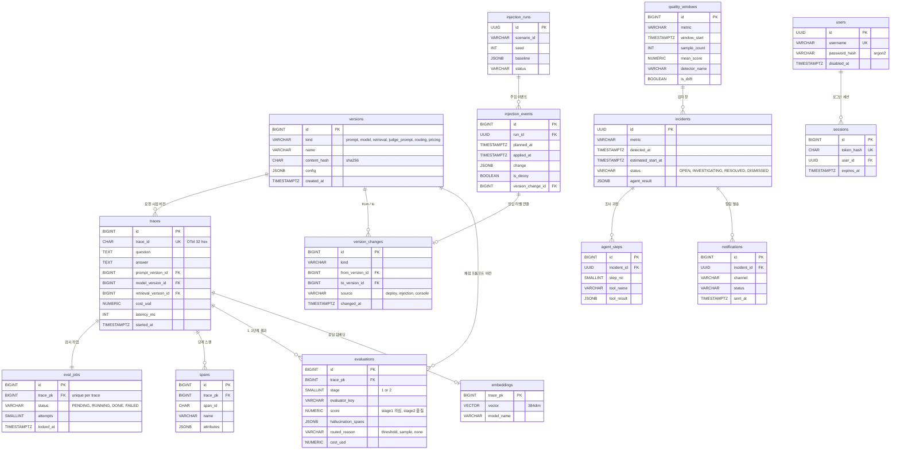

# ERD

> **최종 수정**: 2026-10-26

---

## 1. 설계 원칙

| 항목 | 규칙 |
| --- | --- |
| DB 접근 | Ingest API · Eval Worker · Drift Monitor · Console API만 직접 접근. 콘솔(Next.js)과 원인 분석 에이전트는 API·MCP 경유 |
| PK | 클라이언트 노출 테이블 `UUID` / 내부·로그 테이블 `BIGINT IDENTITY` |
| 열거형 | `VARCHAR` + `CHECK` 제약 (DB ENUM 미사용 — 값 추가 시 마이그레이션 번거로움) |
| JSON | `JSONB` 저장 가능. 집계에 쓰는 값(점수·비용·토큰·라우팅 사유)은 별도 컬럼으로 정규화 |
| 시간 | `TIMESTAMPTZ`, UTC 저장. 표시 변환은 애플리케이션 계층에서 처리 |
| 네이밍 | 테이블·컬럼 `snake_case`, 테이블명 복수형 |
| 삭제 | 기본은 하드 삭제 금지. 계정만 소프트 삭제(`disabled_at`), 나머지는 보관 기간 초과 시 물리 삭제 (11장) |
| FK | 서비스 내부 FK는 걸고, 외부 서비스 참조는 ID만 저장. `ON DELETE CASCADE` 금지 (`RESTRICT` 사용) |
| 기본값 | 애플리케이션 코드에서 지정, DB `DEFAULT` 미사용. 단 `BIGINT IDENTITY`는 예외 |
| 재변경 금지 | 스냅샷 컬럼(검사 결과, 비용, 버전 연결 등)은 INSERT 후 UPDATE 금지 |
| 작업 큐 | 별도 브로커 없이 `eval_jobs` 테이블 + `FOR UPDATE SKIP LOCKED`로 운영. 트레이스 INSERT와 작업 INSERT는 **같은 트랜잭션** (ADR-004) |
| 버전 원본 | 버전의 원본은 Git `configs/` 파일. DB는 내용 해시 레지스트리이며 **DB를 직접 수정해 버전을 만들지 않는다** (ADR-005) |
| 변경 이력 단일화 | 배포·주입·콘솔 설정 변경을 모두 `version_changes` 한 테이블에 `source`로 구분해 기록 |
| 에이전트 권한 | 에이전트용 DB 계정은 **read-only**. MCP 도구는 SELECT만 수행 (ADR-007) |
| 불변 테이블 | `[IMMUTABLE]` 표시 테이블은 `updated_at`을 두지 않고 UPDATE를 금지한다 |
| 스키마 변경 | Alembic 마이그레이션이 유일한 변경 경로. 수동 DDL 금지 (ADR-022) |
| **점수 방향** | `evaluations.score`: stage 1은 **환각 의심 점수**(0=clean, 1=likely hallucinated), stage 2는 **품질 점수**(0=bad, 1=good). 방향이 반대이므로 콘솔의 "품질 점수" 표시는 stage 2가 있으면 그 값, 없으면 `1 − stage_1_score`로 변환한다 |
| **창 집계 기준** | `quality_windows` 집계는 `traces.started_at`을 창 배분 기준으로 삼는다. 비동기 처리 지연이 창 귀속에 영향을 주지 않게 하기 위함 (ADR-029) |
| **버전 FK 방식** | 트레이스에 버전을 연결 테이블(`trace_versions`)이 아닌 FK 컬럼 3개로 붙인다. 버전 종류가 3~4개로 고정되어 있고 버전별 조회가 빈번해 JOIN 없이 직접 접근하는 편이 유리하다 |
| **원인 후보 정규화** | `incidents.top1_version_change_id` FK로 1순위를 정규화하고 전체 순위는 `agent_result` JSONB에 보관한다. 별도 `incident_candidates` 테이블을 두지 않는다 |

---

## 2. ERD

- **ERD 도구**: ERDCloud
- **ERD 링크**: {링크 — SP2 9주차 DB 스키마 확정 시 작성}



- ERD에는 핵심 컬럼만 표시한다. 전체 컬럼은 5장 테이블 명세를 참조한다.
- `traces`는 `trace_id`(OTel 32자리 hex)로 외부에 노출되므로 PK는 내부용 `BIGINT`, `trace_id`에 유니크 제약을 둔다.

---

## 3. 테이블 목록

| # | 테이블명 | 설명 | 비고 |
| --- | --- | --- | --- |
| **A. 수집** |  |  |  |
| 1 | `traces` | 요청 1건의 질문·응답·문맥·토큰·비용·지연과 그 시점의 버전 묶음 | `[IMMUTABLE]` |
| 2 | `spans` | RAG 단계별(검색·조립·생성) OTel 스팬 | `[IMMUTABLE]` |
| **B. 버전** |  |  |  |
| 3 | `versions` | 프롬프트·모델·검색 설정 등의 버전 레지스트리(내용 해시) | `[IMMUTABLE]` · Git이 원본 |
| 4 | `version_changes` | 변경 이력. 원인 분석의 핵심 근거 | `[IMMUTABLE]` |
| **C. 검사** |  |  |  |
| 5 | `eval_jobs` | 비동기 검사 작업 큐 (`SKIP LOCKED`) | 상태가 자주 바뀌는 유일한 테이블 |
| 6 | `evaluations` | 1·2단계 검사 결과와 라우팅 사유 | `[IMMUTABLE]` |
| 7 | `embeddings` | 드리프트 감지용 응답 임베딩(384차원) | `[IMMUTABLE]` · pgvector |
| **D. 감시·분석** |  |  |  |
| 8 | `quality_windows` | 시간 창별 품질 집계와 드리프트 판정 결과 | `[IMMUTABLE]` |
| 9 | `incidents` | 품질 저하 인시던트와 에이전트 결론 | 상태 변경 있음 |
| 10 | `agent_steps` | 에이전트의 도구 호출 기록(조사 과정 화면의 원천) | `[IMMUTABLE]` |
| 11 | `notifications` | 알림 발송 이력. 인시던트당 1회·쿨다운 근거 | 발송 결과만 갱신 |
| **E. 실험** |  |  |  |
| 12 | `injection_runs` | 품질 저하 주입 실험 1회차 | 시나리오 YAML과 1:1 |
| 13 | `injection_events` | 주입된 개별 변경 = **정답 라벨** | `[IMMUTABLE]` |
| **F. 계정** |  |  |  |
| 14 | `users` | 콘솔 로그인 계정(시드 생성, 회원가입 없음) | 소프트 삭제 |
| 15 | `sessions` | 세션 토큰 해시와 만료 | 만료·폐기 갱신 |

신규 테이블 추가 시 이 표와 8·9·10장을 함께 갱신한다.

---

## 4. 테이블 명세 신규 추가 템플릿

> 신규 테이블을 추가할 때 아래 링크의 템플릿을 복사해 5장의 해당 도메인 아래에 붙여넣는다.  
> 추가 후 3장 테이블 목록, 8장 코드값, 9장 인덱스, 10장 DDL도 함께 갱신한다.

**ERD 템플릿:** [docs\specs\template\erd-template.md](docs\specs\template\erd-template.md)

---

## 5. 테이블 명세

### 5.1 수집 도메인

#### traces `[IMMUTABLE]`

> 감시 대상 서비스의 요청 1건을 저장한다. 질문·응답·검색 문맥과 토큰·비용·지연, 그리고 **그 요청이 사용한 버전 묶음**을 함께 남긴다. 이 테이블이 플랫폼의 사실상 사실 원천이다.
> 

**컬럼 명세**

| 컬럼 | 타입 | 제약 | NULL | 기본값 | 설명 |
| --- | --- | --- | --- | --- | --- |
| id | BIGINT | PK, IDENTITY | N | — | 내부 기본 키 |
| trace_id | CHAR(32) | UNIQUE | N | — | OTel trace id (hex 32자리) |
| service_name | VARCHAR(100) | — | N | — | 감시 대상 서비스 식별자 |
| question | TEXT | — | N | — | 사용자 질문 |
| answer | TEXT | — | Y | — | 생성된 응답. 실패 시 NULL |
| contexts | JSONB | — | Y | — | 검색된 근거 문서 목록 `[{doc_id, score, text}]`. 1단계 탐지 입력 |
| provider | VARCHAR(50) | — | N | — | `gen_ai.provider.name` (예: anthropic) |
| model_name | VARCHAR(100) | — | N | — | `gen_ai.request.model` |
| input_tokens | INT | CHECK >= 0 | N | — | `gen_ai.usage.input_tokens` |
| output_tokens | INT | CHECK >= 0 | N | — | `gen_ai.usage.output_tokens` |
| cost_usd | NUMERIC(12,6) | CHECK >= 0 | N | — | SDK 단가표 기반 요청 단위 비용 (ADR-025) |
| latency_ms | INT | CHECK >= 0 | N | — | 요청 처리 지연 |
| prompt_version_id | BIGINT | FK → versions.id | Y | — | 요청 시점 프롬프트 버전 |
| model_version_id | BIGINT | FK → versions.id | Y | — | 요청 시점 모델 설정 버전 |
| retrieval_version_id | BIGINT | FK → versions.id | Y | — | 요청 시점 검색 설정 버전 |
| injection_run_id | UUID | FK → injection_runs.id | Y | — | 주입 실험 중 발생한 요청이면 해당 회차 |
| status | VARCHAR(20) | CHECK | N | — | `OK` / `ERROR` |
| error_message | TEXT | — | Y | — | 생성 실패 사유 |
| started_at | TIMESTAMPTZ | — | N | — | 요청 시작 시각(UTC). `quality_windows` 창 배분 기준 |
| ended_at | TIMESTAMPTZ | — | N | — | 요청 종료 시각(UTC) |
| created_at | TIMESTAMPTZ | — | N | — | 수집 저장 시각 |

**제약 및 인덱스**

| 이름 | 대상 컬럼 | 설명 |
| --- | --- | --- |
| uq_traces_trace_id | `trace_id` | 재전송·중복 수집 시 같은 트레이스가 두 번 저장되지 않게 한다 |
| idx_traces_started_at | `started_at DESC` | 대시보드 시계열과 최근 트레이스 목록 조회 |
| idx_traces_prompt_version | `prompt_version_id, started_at` | 버전별 A/B 비교, 에이전트의 `compare_versions` |
| idx_traces_retrieval_version | `retrieval_version_id, started_at` | 검색 설정 버전별 품질 비교 |
| idx_traces_injection_run | `injection_run_id` (부분) | 주입 실험 구간 추출 (NULL 제외 부분 인덱스) |

**상태값**

| 컬럼 | 상태 | 의미 |
| --- | --- | --- |
| status | OK | 응답 생성 성공 |
| status | ERROR | 생성 실패(제공자 오류·타임아웃) |

**비고**

- 버전 FK가 NULL 가능한 이유는 계측 SDK를 붙이지 않은 요청도 수집될 수 있기 때문이다. **버전 3종이 모두 채워진 트레이스만 원인 분석과 A/B 비교의 모집단**이 된다(7장 정합성 규칙).
- 버전을 연결 테이블(`trace_versions`)이 아닌 FK 컬럼 3개로 붙인 이유는, 버전 종류가 3~4개로 고정되어 있고 버전별 조회(인덱스 scan)가 빈번해 JOIN 없이 직접 접근하는 편이 쿼리가 단순하고 빠르기 때문이다. 버전 종류가 동적으로 늘어날 가능성이 생기면 재검토한다.
- `started_at` 컬럼은 `quality_windows` 집계의 창 배분 기준이다. 비동기 처리 지연으로 `evaluations.created_at`이 달라져도 창 귀속이 흔들리지 않는다.
- `answer`·`contexts`에 사용자 데이터가 그대로 들어가므로 조회 API는 전면 로그인 필수다(ADR-017).
- 표준 속성(`gen_ai.*`)은 정규화 컬럼으로, 자체 속성(`app.*`)과 미분류 속성은 `spans.attributes`에 원본 그대로 남긴다(ADR-002).

#### spans `[IMMUTABLE]`

> 한 요청 안의 단계별 스팬을 저장한다. 검색 → 프롬프트 조립 → 생성 중 어느 단계에서 지연·이상이 발생했는지 추적하는 데 쓴다.
> 

**컬럼 명세**

| 컬럼 | 타입 | 제약 | NULL | 기본값 | 설명 |
| --- | --- | --- | --- | --- | --- |
| id | BIGINT | PK, IDENTITY | N | — | 기본 키 |
| trace_pk | BIGINT | FK → traces.id, RESTRICT | N | — | 소속 트레이스 |
| span_id | CHAR(16) | — | N | — | OTel span id |
| parent_span_id | CHAR(16) | — | Y | — | 상위 스팬. 루트는 NULL |
| name | VARCHAR(100) | — | N | — | 스팬 이름 (`retrieve`, `build_prompt`, `chat`) |
| kind | VARCHAR(20) | CHECK | N | — | `RETRIEVAL` / `PROMPT` / `LLM` / `OTHER` |
| attributes | JSONB | — | Y | — | `gen_ai.*` · `app.*` 원본 속성 |
| started_at | TIMESTAMPTZ | — | N | — | 시작 시각 |
| ended_at | TIMESTAMPTZ | — | N | — | 종료 시각 |
| created_at | TIMESTAMPTZ | — | N | — | 저장 시각 |

**제약 및 인덱스**

| 이름 | 대상 컬럼 | 설명 |
| --- | --- | --- |
| uq_spans_span_id | `trace_pk, span_id` | 같은 스팬의 중복 저장 방지 |
| idx_spans_trace_pk | `trace_pk, started_at` | 트레이스 상세 화면에서 단계 순서대로 조회 |

**비고**

- 속성 키 탐색이 필요해지면 `attributes`에 GIN 인덱스를 추가한다. 초기에는 데이터량이 작아 생략한다(9장).
- OTel 시맨틱 컨벤션 버전은 고정하고 매핑 계층을 거쳐 저장하므로, 표준 변경이 이 테이블 스키마를 바꾸지 않는다(ADR-002).

### 5.2 버전 도메인

#### versions `[IMMUTABLE]`

> 프롬프트·모델·검색 설정·채점 프롬프트·라우팅 정책·단가표의 버전 레지스트리다. 원본은 Git `configs/` 파일이고, 서비스 기동 시 내용 해시를 계산해 이 테이블에 등록한다(ADR-005).
> 

**컬럼 명세**

| 컬럼 | 타입 | 제약 | NULL | 기본값 | 설명 |
| --- | --- | --- | --- | --- | --- |
| id | BIGINT | PK, IDENTITY | N | — | 기본 키 |
| kind | VARCHAR(30) | CHECK | N | — | `prompt` / `model` / `retrieval` / `judge_prompt` / `routing` / `pricing` |
| name | VARCHAR(100) | — | N | — | 사람이 읽는 버전 이름 (예: `v1.3-terse`) |
| content_hash | CHAR(64) | — | N | — | 설정 내용의 SHA-256. **같은 해시 = 같은 버전** |
| source_path | VARCHAR(300) | — | Y | — | 원본 파일 경로 (`configs/prompts/qa.md`) |
| git_commit | CHAR(40) | — | Y | — | 등록 시점 커밋. 런타임 주입은 NULL |
| config | JSONB | — | N | — | 설정 전문 스냅샷 |
| created_at | TIMESTAMPTZ | — | N | — | 최초 등록 시각 |

**제약 및 인덱스**

| 이름 | 대상 컬럼 | 설명 |
| --- | --- | --- |
| uq_versions_kind_hash | `kind, content_hash` | 동일 내용 재배포 시 새 버전이 생기지 않게 한다 |
| idx_versions_kind_created | `kind, created_at DESC` | 종류별 최신 버전 조회 |

**비고**

- `kind='routing'`은 콘솔에서 바꾸는 τ·표본 비율 정책이고, `kind='pricing'`은 비용 계산 단가표다. 둘 다 "변경"이므로 버전으로 다뤄 원인 후보에 포함시킨다(ADR-025).
- `kind='judge_prompt'`는 채점자 자체의 변동과 서비스 품질 저하를 구분하기 위한 것이다.
- 이 테이블은 **애플리케이션이 Git 파일을 읽어서만 INSERT**한다. 사람이 직접 INSERT/UPDATE하지 않는다.

#### version_changes `[IMMUTABLE]`

> 버전이 바뀐 사건을 기록한다. 원인 분석 에이전트가 가장 먼저 조회하는 테이블이며, 주입 실험에서는 정답 라벨과 연결된다.
> 

**컬럼 명세**

| 컬럼 | 타입 | 제약 | NULL | 기본값 | 설명 |
| --- | --- | --- | --- | --- | --- |
| id | BIGINT | PK, IDENTITY | N | — | 기본 키 |
| kind | VARCHAR(30) | CHECK | N | — | versions.kind와 동일 코드값 |
| from_version_id | BIGINT | FK → versions.id, RESTRICT | Y | — | 직전 버전. 최초 등록이면 NULL |
| to_version_id | BIGINT | FK → versions.id, RESTRICT | N | — | 변경 후 버전 |
| source | VARCHAR(20) | CHECK | N | — | `deploy` / `injection` / `console` |
| git_commit | CHAR(40) | — | Y | — | 배포 변경의 커밋 |
| actor | VARCHAR(100) | — | Y | — | 변경 주체(배포 워크플로, 콘솔 사용자명, 시나리오 id) |
| changed_at | TIMESTAMPTZ | — | N | — | 변경이 적용된 시각 |

**제약 및 인덱스**

| 이름 | 대상 컬럼 | 설명 |
| --- | --- | --- |
| idx_version_changes_changed_at | `changed_at DESC` | 기간별 변경 이력 조회 (`list_version_changes`) |
| idx_version_changes_kind_changed | `kind, changed_at DESC` | 종류별 이력, A/B 비교 대상 선정 |

**상태값**

| 컬럼 | 상태 | 의미 |
| --- | --- | --- |
| source | deploy | 배포로 인한 변경 |
| source | injection | 주입 실험의 런타임 교체 |
| source | console | 콘솔에서 정책·알림 설정 변경 |

**비고**

- `source`를 나눈 이유는 평가 때문이다. 주입 실험의 Top-1 정확도는 `source='injection'` 행을 정답으로 삼고, `deploy`·`console` 행은 디코이로 함께 후보에 올라간다(ADR-026).
- 시간 정밀도가 곧 탐지 지연 측정의 정밀도이므로 `changed_at`은 적용 완료 시각을 밀리초까지 기록한다.

### 5.3 검사 도메인

#### eval_jobs

> 비동기 검사 작업 큐다. 별도 브로커 없이 `SELECT … FOR UPDATE SKIP LOCKED`로 워커가 작업을 점유한다(ADR-004). 전체 스키마에서 상태가 자주 바뀌는 유일한 테이블이다.
> 

**컬럼 명세**

| 컬럼 | 타입 | 제약 | NULL | 기본값 | 설명 |
| --- | --- | --- | --- | --- | --- |
| id | BIGINT | PK, IDENTITY | N | — | 기본 키 |
| trace_pk | BIGINT | FK → traces.id, RESTRICT, UNIQUE | N | — | 검사 대상 트레이스 |
| status | VARCHAR(20) | CHECK | N | — | `PENDING` / `RUNNING` / `DONE` / `FAILED` |
| attempts | SMALLINT | CHECK >= 0 | N | — | 시도 횟수. 상한 초과 시 FAILED |
| available_at | TIMESTAMPTZ | — | N | — | 재시도 백오프용 — 이 시각 이후에만 점유 가능 |
| locked_at | TIMESTAMPTZ | — | Y | — | 점유 시각. stale lock 회수 기준 |
| locked_by | VARCHAR(100) | — | Y | — | 점유한 워커 식별자 |
| last_error | TEXT | — | Y | — | 마지막 실패 사유 |
| created_at | TIMESTAMPTZ | — | N | — | 등록 시각 |
| updated_at | TIMESTAMPTZ | — | Y | — | 상태 변경 시각 |

**제약 및 인덱스**

| 이름 | 대상 컬럼 | 설명 |
| --- | --- | --- |
| uq_eval_jobs_trace | `trace_pk` | 한 트레이스에 작업이 두 번 등록되지 않게 한다 |
| idx_eval_jobs_queue | `status, available_at` (부분: `status='PENDING'`) | 큐 폴링 전용. 대기 작업만 인덱싱해 크기를 작게 유지 |
| idx_eval_jobs_stale | `locked_at` (부분: `status='RUNNING'`) | 워커 비정상 종료 시 stale lock 회수 |

**상태값**

| 컬럼 | 상태 | 의미 | 전이 조건 |
| --- | --- | --- | --- |
| status | PENDING | 대기 | 트레이스 저장과 **같은 트랜잭션**에서 생성 |
| status | RUNNING | 워커 점유 중 | `SKIP LOCKED`로 선점 |
| status | DONE | 1·2단계 처리 완료 | `evaluations` INSERT 성공 후 |
| status | FAILED | 재시도 상한 초과 | `attempts > MAX_ATTEMPTS` |

**비고**

- `traces` INSERT와 `eval_jobs` INSERT는 반드시 한 트랜잭션이어야 한다. "저장은 됐는데 검사는 안 된" 유실 상태를 막는 것이 이 테이블의 존재 이유다(ADR-004).
- `RUNNING` 상태로 `locked_at`이 5분을 넘긴 행은 스케줄러가 `PENDING`으로 되돌리고 `attempts`를 증가시킨다.

#### evaluations `[IMMUTABLE]`

> 1단계 경량 탐지와 2단계 LLM 채점의 결과를 저장한다. 라우팅 사유가 함께 남아 2단 구조의 비용·누락률 분석의 원천이 된다.
> 

**컬럼 명세**

| 컬럼 | 타입 | 제약 | NULL | 기본값 | 설명 |
| --- | --- | --- | --- | --- | --- |
| id | BIGINT | PK, IDENTITY | N | — | 기본 키 |
| trace_pk | BIGINT | FK → traces.id, RESTRICT | N | — | 대상 트레이스 |
| stage | SMALLINT | CHECK IN (1,2) | N | — | 1 = 경량 탐지, 2 = LLM 채점 |
| evaluator_key | VARCHAR(100) | — | N | — | 평가자 식별자. 1단계: `{모델명}-{서빙형식}` (예: `lettucedetect-base-onnx-int8`), 2단계: `{채점모델명}-{프롬프트버전}` |
| score | NUMERIC(5,4) | CHECK 0~1 | N | — | **stage 1: 환각 의심 점수**(높을수록 의심↑) / **stage 2: 품질 점수**(높을수록 좋음↑) |
| label | VARCHAR(20) | CHECK | Y | — | `SUPPORTED` / `HALLUCINATED` / `UNVERIFIABLE` |
| hallucination_spans | JSONB | — | Y | — | 근거 없는 구간 `[{start, end, text}]`. 화면 하이라이트 원천 |
| routed_reason | VARCHAR(20) | CHECK | N | — | `threshold` / `sample` / `none` |
| reason_text | TEXT | — | Y | — | 2단계 채점 판정 이유 |
| judge_prompt_version_id | BIGINT | FK → versions.id, RESTRICT | Y | — | 2단계 채점 프롬프트 버전 |
| input_tokens | INT | CHECK >= 0 | Y | — | 2단계 채점 입력 토큰 |
| output_tokens | INT | CHECK >= 0 | Y | — | 2단계 채점 출력 토큰 |
| cost_usd | NUMERIC(12,6) | CHECK >= 0 | N | — | 검사 1건 비용. 1단계는 0 |
| latency_ms | INT | CHECK >= 0 | N | — | 검사 소요 시간 |
| created_at | TIMESTAMPTZ | — | N | — | 저장 시각 |

**제약 및 인덱스**

| 이름 | 대상 컬럼 | 설명 |
| --- | --- | --- |
| uq_evaluations_trace_stage_evaluator | `trace_pk, stage, evaluator_key` | 같은 평가자가 같은 트레이스를 중복 채점하지 않게 한다. 평가자(모델·프롬프트)가 다르면 추가 행 허용 |
| idx_evaluations_created_at | `created_at DESC` | 시간 창 집계(Drift Monitor) |
| idx_evaluations_stage_routed | `stage, routed_reason` | 누락률·비용 절감률 계산 |
| idx_evaluations_trace | `trace_pk` | 트레이스 상세 화면 |

**상태값**

| 컬럼 | 상태 | 의미 | 전이 조건 |
| --- | --- | --- | --- |
| routed_reason | threshold | 1단계 점수가 τ 이상이라 2단계로 보냄 | `score >= τ` |
| routed_reason | sample | 무작위 표본으로 2단계로 보냄 | 비율 `r` 추첨 당첨 |
| routed_reason | none | 2단계로 보내지 않음(1단계 행에 기록) | 위 두 조건 미해당 |

**비고**

- **점수 방향이 stage마다 반대다.** stage 1의 `score`는 환각 의심 점수(높을수록 환각 가능성 높음)이고, stage 2의 `score`는 품질 점수(높을수록 품질 좋음)이다. 콘솔의 "품질 점수" 시계열은 stage 2 결과가 있으면 그 값, 없으면 `1 − stage_1_score`로 표시 레이어에서 변환한다. 라우팅 임계값 τ는 stage 1 점수에 적용(`score >= τ`).
- `evaluator_key`에 서빙 형식(`onnx-int8`, `fp32`)을 포함하는 이유는, 같은 모델이라도 최적화 형식이 바뀌면 점수가 달라질 수 있어 비교 실험(ADR-027)에서 구분해야 하기 때문이다. 형식: `{모델명}-{서빙형식}`, 100자 이내. 예: `lettucedetect-modernbert-base-onnx-int8`. `interfaces.md` `Detector.name` 절 참조.
- `evaluator_key`를 UNIQUE 키에 포함한 이유: ① 공개 모델(LettuceDetect)과 자체 모델을 같은 트레이스에 대해 비교 평가하기 위해(ADR-027), ② 타 제공자 채점자로 표본을 재채점해 교차 검증하기 위해(ADR-015). MVP에서는 재평가를 운영 DB가 아니라 실험 스크립트(`experiments/`)로 처리하므로 이 제약으로 충분하다.
- **누락률**은 `routed_reason='sample'`인 2단계 결과 중 1단계가 정상으로 판정했던 건의 비율로 계산한다. 무작위 표본 라우팅이 비용이 아니라 측정 장치인 이유다.

#### embeddings `[IMMUTABLE]`

> 응답 임베딩을 저장한다. 품질 점수 외에 **응답 분포 자체의 변화**로 드리프트를 감지하는 데 쓴다(ADR-029).
> 

**컬럼 명세**

| 컬럼 | 타입 | 제약 | NULL | 기본값 | 설명 |
| --- | --- | --- | --- | --- | --- |
| trace_pk | BIGINT | PK, FK → traces.id, RESTRICT | N | — | 대상 트레이스(1:1) |
| vector | VECTOR(384) | — | N | — | 응답 임베딩 (all-MiniLM-L6-v2) |
| model_name | VARCHAR(100) | — | N | — | 임베딩 모델 식별자. 모델이 바뀌면 이전 임베딩과 거리 비교가 무의미하므로 **같은 `model_name`끼리만 비교**한다 |
| created_at | TIMESTAMPTZ | — | N | — | 생성 시각 (비동기 처리 시각. 창 배분에는 `traces.started_at`을 사용하므로 이 값과 다를 수 있다) |

**제약 및 인덱스**

| 이름 | 대상 컬럼 | 설명 |
| --- | --- | --- |
| idx_embeddings_vector | `vector` (HNSW, `vector_cosine_ops`) | 임베딩 거리 기반 드리프트 비교. 데이터가 쌓인 뒤 생성 |
| idx_embeddings_created_at | `created_at` | 창별 임베딩 집합 조회 |

**비고**

- 임베딩 대상 텍스트: LLM 응답(`traces.answer`)만. 질문·문맥은 포함하지 않는다.
- 차원 수가 모델에 묶여 있으므로(384), 다국어 모델로 교체하면 차원이 달라져 컬럼 변경 마이그레이션이 필요하다. 한국어 확장 실험 시 별도 테이블로 분리하는 편이 안전하다(미결정 사항).
- all-MiniLM-L6-v2는 입력이 256 word piece를 초과하면 잘라낸다. 긴 응답은 앞부분만 임베딩에 반영되므로, 운영 전에 서비스 응답 길이 분포를 확인하고 필요하면 문장 단위 임베딩 평균 방식으로 보완한다(ADR-029 미결 사항).
- HNSW 인덱스는 데이터가 수천 건 이하일 때 효과가 없으므로, SP3 주입 실험으로 데이터가 쌓인 뒤 생성한다(9장).

### 5.4 감시·분석 도메인

#### quality_windows `[IMMUTABLE]`

> 시간 창(기본 5분)별 품질 집계와 드리프트 판정 결과를 저장한다. 대시보드 시계열, 탐지 지연·오탐률 측정, 에이전트의 `get_quality_timeseries`가 모두 이 테이블을 읽는다.
> 

**컬럼 명세**

| 컬럼 | 타입 | 제약 | NULL | 기본값 | 설명 |
| --- | --- | --- | --- | --- | --- |
| id | BIGINT | PK, IDENTITY | N | — | 기본 키 |
| metric | VARCHAR(50) | CHECK | N | — | `quality_score` / `hallucination_rate` / `embedding_distance` |
| window_start | TIMESTAMPTZ | — | N | — | 창 시작(UTC). **`traces.started_at` 기준으로 배분** |
| window_end | TIMESTAMPTZ | — | N | — | 창 종료(UTC) |
| window_size_sec | INT | CHECK > 0 | N | — | 창 길이(초). 5분·15분 비교 실험 변수 |
| sample_count | INT | CHECK >= 0 | N | — | 창 내 표본 수. 부족 시 판정 보류 근거 |
| mean_score | NUMERIC(5,4) | — | Y | — | 평균 품질 점수. `quality_score` 지표일 때 채움. stage 2 있으면 stage 2 값, 없으면 `1 − stage_1_score` 집계 |
| hallucination_rate | NUMERIC(5,4) | — | Y | — | 환각 판정 비율. `hallucination_rate` 지표일 때 채움 |
| drift_score | NUMERIC(10,6) | — | Y | — | 판정기가 산출한 통계량(KS 통계량, 임베딩 거리 등) |
| detector_name | VARCHAR(50) | CHECK | N | — | `fixed_threshold` / `ks_test` / `embedding_distance` |
| detector_config | JSONB | — | Y | — | 민감도 등 판정기 설정 스냅샷 |
| is_drift | BOOLEAN | — | N | — | 저하로 판정했는지 |
| computed_at | TIMESTAMPTZ | — | N | — | 집계 수행 시각 |

**제약 및 인덱스**

| 이름 | 대상 컬럼 | 설명 |
| --- | --- | --- |
| uq_quality_windows | `metric, detector_name, window_size_sec, window_start` | 같은 조건의 창이 중복 집계되지 않게 한다 |
| idx_quality_windows_series | `metric, window_start DESC` | 대시보드 시계열 조회 |
| idx_quality_windows_drift | `is_drift, window_start DESC` (부분) | 드리프트 구간만 추출 |

**비고**

- **창 배분 기준: `traces.started_at`**. 비동기 처리 지연으로 `evaluations.created_at`이 실제 요청 시각보다 늦어도 창 귀속이 올바르다. Drift Monitor는 집계 시 `JOIN traces ON traces.id = evaluations.trace_pk WHERE traces.started_at BETWEEN window_start AND window_end`로 쿼리한다.
- 판정기 3종을 **같은 창에 대해 동시에 기록**하므로 `detector_name`이 UNIQUE 키에 들어간다. 이것이 과제 C의 "방식별 탐지율·탐지 지연·오탐 횟수 비교" 표를 SQL 하나로 뽑을 수 있게 하는 핵심 설계다.
- `sample_count`가 30 미만이면 `is_drift=false`, `drift_score=NULL`로 두고 집계 행 자체는 남긴다. 표본 부족에 의한 오탐과 실제 정상을 구분하기 위해서다.
- `mean_score`는 콘솔 "품질 점수" 시계열에 직접 표시되므로 1장 설계 원칙의 변환 규칙(`stage 2 있으면 그 값, 없으면 1 − stage_1_score`)을 이미 적용한 값을 저장한다.
- 이 테이블은 재계산 시 UPDATE하지 않고 같은 조건의 기존 행을 삭제한 뒤 다시 INSERT한다(불변 유지).

#### incidents

> 드리프트 판정으로 생성된 품질 저하 사건과 에이전트의 결론을 저장한다. 인시던트 상세 화면의 기준 레코드다.
> 

**컬럼 명세**

| 컬럼 | 타입 | 제약 | NULL | 기본값 | 설명 |
| --- | --- | --- | --- | --- | --- |
| id | UUID | PK | N | — | 외부 노출 식별자(알림 링크에 포함) |
| metric | VARCHAR(50) | CHECK | N | — | 저하가 감지된 지표 |
| detector_name | VARCHAR(50) | CHECK | N | — | 인시던트를 만든 판정기 |
| trigger_window_id | BIGINT | FK → quality_windows.id, RESTRICT | N | — | 트리거가 된 집계 창 |
| detected_at | TIMESTAMPTZ | — | N | — | 감지 시각 |
| estimated_start_at | TIMESTAMPTZ | — | Y | — | 저하 시작 추정 시각. **탐지 지연 = `detected_at` − `injection_events.applied_at` 계산 기준** |
| status | VARCHAR(20) | CHECK | N | — | `OPEN` / `INVESTIGATING` / `RESOLVED` / `DISMISSED` |
| agent_result | JSONB | — | Y | — | 원인 후보 전체 순위·신뢰도·근거(구조화 JSON). Top-3 정확도는 이 배열에서 계산 |
| agent_fallback | BOOLEAN | — | N | — | 상한 도달로 규칙 기반 결과를 쓴 경우 true |
| top1_version_change_id | BIGINT | FK → version_changes.id, RESTRICT | Y | — | 1순위 원인 후보. **Top-1 정확도 자동 채점의 직접 비교 대상** |
| resolved_at | TIMESTAMPTZ | — | Y | — | 종료 시각 |
| created_at | TIMESTAMPTZ | — | N | — | 생성 시각 |
| updated_at | TIMESTAMPTZ | — | Y | — | 상태 변경 시각 |

**제약 및 인덱스**

| 이름 | 대상 컬럼 | 설명 |
| --- | --- | --- |
| idx_incidents_detected_at | `detected_at DESC` | 대시보드 최근 알림 목록 |
| idx_incidents_status | `status, detected_at DESC` | 진행 중 인시던트 조회 |
| uq_incidents_open_metric | `metric, detector_name` (부분: `status IN ('OPEN','INVESTIGATING')`) | 같은 지표로 열린 인시던트가 동시에 둘 생기지 않게 한다 |

**상태값**

| 컬럼 | 상태 | 의미 | 전이 조건 |
| --- | --- | --- | --- |
| status | OPEN | 생성 직후, 조사 전 | 드리프트 판정 시 |
| status | INVESTIGATING | 에이전트 조사 중 | 에이전트 루프 시작 |
| status | RESOLVED | 원인 제시 완료 또는 품질 회복 | 에이전트 결론 저장 / 지표 정상화 |
| status | DISMISSED | 오탐으로 판단해 종료 | 운영자 또는 표본 부족 판정 |

**비고**

- **원인 후보 정규화 설계**: 전체 순위는 `agent_result` JSONB에, 1순위만 `top1_version_change_id` FK로 정규화한다. `incident_candidates` 별도 테이블을 두지 않은 이유는 Top-1 정확도 자동 채점이 FK 조인 1회로 충분하고, 이번 범위에서 후보 수가 적다(3~5개). 후보 목록에 대한 추가 쿼리(예: Top-3 상세 분석)가 필요해지면 정규화를 검토한다.
- `top1_version_change_id`는 `agent_result`의 1순위 후보와 항상 일치해야 한다(7장 정합성 규칙).
- `estimated_start_at`은 에이전트가 추정한 값과 실제 주입 시각을 구분해 기록한다. 탐지 지연은 `detected_at − injection_events.applied_at`으로 계산한다.
- `agent_fallback=true`인 인시던트는 에이전트 성능 평가 모집단에서 제외한다.

#### agent_steps `[IMMUTABLE]`

> 에이전트가 호출한 MCP 도구와 그 결과를 순서대로 남긴다. 인시던트 상세의 "조사 과정" 섹션은 이 테이블을 그대로 렌더링한다.
> 

**컬럼 명세**

| 컬럼 | 타입 | 제약 | NULL | 기본값 | 설명 |
| --- | --- | --- | --- | --- | --- |
| id | BIGINT | PK, IDENTITY | N | — | 기본 키 |
| incident_id | UUID | FK → incidents.id, RESTRICT | N | — | 소속 인시던트 |
| step_no | SMALLINT | CHECK >= 1 | N | — | 호출 순번 |
| tool_name | VARCHAR(50) | CHECK | N | — | `list_version_changes` / `get_quality_timeseries` / `compare_versions` / `search_traces` / `get_judge_feedback` |
| tool_args | JSONB | — | N | — | 도구 입력 |
| tool_result | JSONB | — | Y | — | 도구 출력 요약. 실패 시 NULL |
| error_message | TEXT | — | Y | — | 도구 호출 실패 사유 |
| input_tokens | INT | CHECK >= 0 | Y | — | 해당 단계 입력 토큰 |
| output_tokens | INT | CHECK >= 0 | Y | — | 해당 단계 출력 토큰 |
| created_at | TIMESTAMPTZ | — | N | — | 호출 시각 |

**제약 및 인덱스**

| 이름 | 대상 컬럼 | 설명 |
| --- | --- | --- |
| uq_agent_steps_order | `incident_id, step_no` | 순번 중복 방지, 화면 정렬 보장 |
| idx_agent_steps_incident | `incident_id` | 조사 과정 전체 조회 |

**비고**

- 이 테이블의 행 수와 토큰 합계가 과제 D의 "조사 1건당 호출 수·비용" 지표다.
- 에이전트는 read-only 계정으로 조회만 하고, 이 테이블에 쓰는 주체는 에이전트를 호출한 서비스 코드다(ADR-007).

#### notifications

> 인시던트 알림 발송 이력이다. "인시던트당 1회 알림"과 재알림 쿨다운의 근거가 된다.
> 

**컬럼 명세**

| 컬럼 | 타입 | 제약 | NULL | 기본값 | 설명 |
| --- | --- | --- | --- | --- | --- |
| id | BIGINT | PK, IDENTITY | N | — | 기본 키 |
| incident_id | UUID | FK → incidents.id, RESTRICT | N | — | 대상 인시던트 |
| channel | VARCHAR(20) | CHECK | N | — | `slack` / `email` |
| dedup_key | VARCHAR(200) | — | N | — | 쿨다운 판정 키 (`metric:detector:날짜시간버킷`) |
| status | VARCHAR(20) | CHECK | N | — | `PENDING` / `SENT` / `FAILED` |
| payload | JSONB | — | N | — | 발송한 메시지 본문 스냅샷 |
| error_message | TEXT | — | Y | — | 발송 실패 사유 |
| sent_at | TIMESTAMPTZ | — | Y | — | 발송 완료 시각 |
| created_at | TIMESTAMPTZ | — | N | — | 생성 시각 |
| updated_at | TIMESTAMPTZ | — | Y | — | 상태 변경 시각 |

**제약 및 인덱스**

| 이름 | 대상 컬럼 | 설명 |
| --- | --- | --- |
| uq_notifications_incident_channel | `incident_id, channel` | 같은 인시던트를 같은 채널로 두 번 알리지 않게 한다 |
| idx_notifications_dedup | `dedup_key, created_at DESC` | 동일 지표 재알림 쿨다운 판정 |

**상태값**

| 컬럼 | 상태 | 의미 |
| --- | --- | --- |
| status | PENDING | 발송 대기 |
| status | SENT | 발송 성공 |
| status | FAILED | 발송 실패 |

**비고**

- 알림 폭주 방지는 두 겹이다. ① `incidents`의 부분 UNIQUE로 중복 인시던트 생성을 막고, ② 이 테이블의 UNIQUE로 중복 발송을 막는다.
- `payload`를 남기는 이유는 알림 설정 화면의 미리보기와 실제 발송 내용이 일치하는지 사후 확인하기 위해서다.

### 5.5 실험 도메인

#### injection_runs

> 품질 저하 주입 실험 1회차를 나타낸다. 시나리오 YAML 파일 하나와 실행 1회가 이 행 하나에 대응한다(ADR-026).
> 

**컬럼 명세**

| 컬럼 | 타입 | 제약 | NULL | 기본값 | 설명 |
| --- | --- | --- | --- | --- | --- |
| id | UUID | PK | N | — | 외부 노출 식별자(실험 결과 파일명에 사용) |
| scenario_id | VARCHAR(100) | — | N | — | 시나리오 식별자 (`s01_prompt_change`) |
| scenario_hash | CHAR(64) | — | N | — | 시나리오 YAML 내용 해시. 재현성 검증용 |
| seed | INT | — | N | — | 질문 순서·표본 추출 고정 시드 |
| baseline | JSONB | — | N | — | 기준 설정 스냅샷 |
| traffic | JSONB | — | N | — | 질문 집합·rps·지속 시간 |
| mode | VARCHAR(20) | CHECK | N | — | `experiment` / `demo` |
| status | VARCHAR(20) | CHECK | N | — | `RUNNING` / `COMPLETED` / `ABORTED` |
| started_at | TIMESTAMPTZ | — | N | — | 실험 시작 |
| ended_at | TIMESTAMPTZ | — | Y | — | 실험 종료 |
| created_at | TIMESTAMPTZ | — | N | — | 생성 시각 |
| updated_at | TIMESTAMPTZ | — | Y | — | 상태 변경 시각 |

**제약 및 인덱스**

| 이름 | 대상 컬럼 | 설명 |
| --- | --- | --- |
| idx_injection_runs_scenario | `scenario_id, started_at DESC` | 시나리오별 10회 반복 결과 조회 |
| idx_injection_runs_status | `status` | 진행 중 실험 확인 |

**상태값**

| 컬럼 | 상태 | 의미 | 전이 조건 |
| --- | --- | --- | --- |
| status | RUNNING | 트래픽 재생·주입 진행 중 | 실험 시작 |
| status | COMPLETED | 정상 종료 | 지속 시간 경과 |
| status | ABORTED | 주입 실패 등으로 중단 | 주입 실패 시 — **이 회차 데이터는 지표 산출에서 제외** |

**비고**

- `mode='demo'`는 발표용 수동 주입이다. 실험 지표 집계에서는 `mode='experiment'`이고 `status='COMPLETED'`인 회차만 사용한다.
- `scenario_hash`를 남기면 "같은 시드로 재실행 시 재현된다"는 인수 기준(T1-15)을 사후에 검증할 수 있다.

#### injection_events `[IMMUTABLE]`

> 한 회차 안에서 실제로 주입된 변경 하나를 기록한다. **이 테이블이 원인 지목 평가의 정답 라벨이다.**
> 

**컬럼 명세**

| 컬럼 | 타입 | 제약 | NULL | 기본값 | 설명 |
| --- | --- | --- | --- | --- | --- |
| id | BIGINT | PK, IDENTITY | N | — | 기본 키 |
| run_id | UUID | FK → injection_runs.id, RESTRICT | N | — | 소속 실험 회차 |
| planned_at | TIMESTAMPTZ | — | N | — | 시나리오가 지정한 주입 예정 시각 |
| applied_at | TIMESTAMPTZ | — | Y | — | 실제 적용 시각. 실패 시 NULL. **탐지 지연 계산 기준** |
| change | JSONB | — | N | — | 주입한 변경 내용 (`{"prompt": "v1.3-terse"}`) |
| is_decoy | BOOLEAN | — | N | — | 디코이 변경 여부. true면 정답이 아니다 |
| version_change_id | BIGINT | FK → version_changes.id, RESTRICT | Y | — | 실제 생성된 변경 이력 행 |
| created_at | TIMESTAMPTZ | — | N | — | 생성 시각 |

**제약 및 인덱스**

| 이름 | 대상 컬럼 | 설명 |
| --- | --- | --- |
| idx_injection_events_run | `run_id, planned_at` | 회차별 주입 순서 조회 |
| uq_injection_events_version_change | `version_change_id` | 하나의 변경 이력이 두 주입 이벤트에 연결되지 않게 한다 |

**비고**

- Top-1 정확도 자동 채점은 `incidents.top1_version_change_id = injection_events.version_change_id AND is_decoy = false` 조인으로 계산한다.
- `is_decoy=true` 이벤트를 섞는 이유는 "하락 직전 변경을 고르는" 규칙 기반 기준선이 자동으로 정답이 되지 않게 하기 위해서다(ADR-026).
- `applied_at`이 NULL인 이벤트가 있으면 해당 회차는 `ABORTED` 처리하고 지표에서 제외한다.

### 5.6 계정 도메인

#### users

> 콘솔 로그인 계정이다. 회원가입은 제공하지 않고 시드 스크립트로 관리자 계정만 생성한다.
> 

**컬럼 명세**

| 컬럼 | 타입 | 제약 | NULL | 기본값 | 설명 |
| --- | --- | --- | --- | --- | --- |
| id | UUID | PK | N | — | 외부 노출 식별자 |
| username | VARCHAR(50) | UNIQUE | N | — | 로그인 아이디 |
| password_hash | VARCHAR(255) | — | N | — | argon2id 해시. 평문·단순 해시 금지 |
| display_name | VARCHAR(100) | — | Y | — | 화면 표시 이름 |
| last_login_at | TIMESTAMPTZ | — | Y | — | 마지막 로그인 시각 |
| disabled_at | TIMESTAMPTZ | — | Y | — | 비활성화 시각(소프트 삭제) |
| created_at | TIMESTAMPTZ | — | N | — | 생성 시각 |
| updated_at | TIMESTAMPTZ | — | Y | — | 수정 시각 |

**제약 및 인덱스**

| 이름 | 대상 컬럼 | 설명 |
| --- | --- | --- |
| uq_users_username | `username` | 로그인 아이디 중복 방지 |

**상태값**

| 컬럼 | 상태 | 의미 |
| --- | --- | --- |
| disabled_at | NULL | 활성 |
| disabled_at | 값 있음 | 비활성 — 로그인 거부 |

#### sessions

> 로그인 세션이다. 토큰 원문은 저장하지 않고 해시만 보관한다(ADR-017).
> 

**컬럼 명세**

| 컬럼 | 타입 | 제약 | NULL | 기본값 | 설명 |
| --- | --- | --- | --- | --- | --- |
| id | BIGINT | PK, IDENTITY | N | — | 기본 키 |
| user_id | UUID | FK → users.id, RESTRICT | N | — | 세션 소유자 |
| token_hash | CHAR(64) | UNIQUE | N | — | 세션 토큰의 SHA-256. 원문은 쿠키에만 존재 |
| user_agent | VARCHAR(300) | — | Y | — | 발급 시 UA |
| expires_at | TIMESTAMPTZ | — | N | — | 만료 시각 |
| revoked_at | TIMESTAMPTZ | — | Y | — | 강제 로그아웃 시각 |
| created_at | TIMESTAMPTZ | — | N | — | 발급 시각 |

**제약 및 인덱스**

| 이름 | 대상 컬럼 | 설명 |
| --- | --- | --- |
| uq_sessions_token_hash | `token_hash` | 토큰 조회 키이자 중복 방지 |
| idx_sessions_expires_at | `expires_at` | 만료 세션 정리 배치 |

**비고**

- 토큰 원문을 저장하지 않으므로 DB가 유출되어도 세션을 그대로 탈취할 수 없다.
- 즉시 로그아웃은 `revoked_at`을 채우는 것으로 처리한다. JWT 대신 세션을 택한 이유가 이 즉시 무효화다(ADR-017).

---

## 6. 공통 컬럼 규칙

| 항목 | 규칙 |
| --- | --- |
| PK | 클라이언트 노출: `id UUID` (`incidents`, `injection_runs`, `users`) / 내부·로그: `id BIGINT GENERATED ALWAYS AS IDENTITY` |
| UUID 생성 | 애플리케이션에서 생성(uuid4). DB `DEFAULT gen_random_uuid()` 미사용 |
| 시간 | `TIMESTAMPTZ`, UTC 저장 |
| 생성 시각 | `created_at` |
| 수정 시각 | `updated_at` (`[IMMUTABLE]` 테이블은 생략) |
| 상태값 | `VARCHAR(20~50)` + `CHECK` 제약, 애플리케이션은 `str` Enum으로 매핑 |
| 금액 | `NUMERIC(12,6)` USD. 부동소수 금지 |
| 점수 | `NUMERIC(5,4)`, 0~1 범위 `CHECK` |
| 토큰·지연 | `INT`, `CHECK >= 0` |
| 해시 | `CHAR(64)` (SHA-256 hex), 커밋은 `CHAR(40)` |
| OTel 식별자 | trace `CHAR(32)`, span `CHAR(16)` (hex 고정 길이) |
| 삭제 | 계정만 `disabled_at` 소프트 삭제. 관측 데이터는 보관 기간 초과 시 물리 삭제(11장) |
| 기본값 | 애플리케이션 코드에서 지정, DB `DEFAULT` 미사용 |

---

## 7. 정합성 규칙

DB 제약만으로 보장할 수 없거나 여러 테이블에 걸친 규칙이다. 애플리케이션 계층에서 보장한다.

**수집·검사**

1. `traces` INSERT와 `eval_jobs` INSERT는 **반드시 같은 트랜잭션**에서 수행한다(ADR-004).
2. `eval_jobs`는 `SELECT … FOR UPDATE SKIP LOCKED`로만 점유한다.
3. 2단계 평가 행(`stage=2`)은 같은 트레이스의 1단계 행이 존재할 때만 INSERT한다.
4. `routed_reason='none'`인 행은 `stage=1`에만 존재한다.
5. `embeddings`는 `traces.answer IS NOT NULL`인 트레이스에 대해서만 생성한다.
6. `quality_windows` 창 배분은 `traces.started_at` 기준으로 수행한다. `evaluations.created_at`이나 `embeddings.created_at`을 기준으로 삼지 않는다.

**버전·변경**

1. `versions`는 애플리케이션이 Git 파일을 읽어서만 INSERT한다.
2. 내용 해시가 직전 버전과 같으면 `version_changes`를 기록하지 않는다.
3. `version_changes.from_version_id`는 같은 `kind`의 직전 버전이어야 한다.
4. 콘솔에서 라우팅 정책이나 알림 설정을 바꾸면 반드시 `versions`(kind=`routing`) INSERT와 `version_changes`(source=`console`) INSERT가 함께 일어난다.

**감시·분석**

1. 같은 `metric`·`detector_name`으로 `OPEN` 또는 `INVESTIGATING` 상태인 인시던트가 이미 있으면 새 인시던트를 만들지 않는다.
2. 인시던트 알림은 채널당 1회만 발송한다. 동일 `dedup_key`가 쿨다운 시간 내에 존재하면 발송을 건너뛴다.
3. `incidents.top1_version_change_id`는 `agent_result`의 1순위 후보와 일치해야 한다.
4. `agent_fallback=true`인 인시던트는 에이전트 정확도 집계에서 제외한다.

**실험**

1. `injection_runs.status='ABORTED'`인 회차의 데이터는 지표 산출 쿼리에서 제외한다.
2. 주입으로 생성된 `version_changes`는 반드시 `injection_events.version_change_id`와 연결된다.
3. 원인 지목 정답 판정은 `is_decoy=false`인 이벤트만 대상으로 한다.

**계정**

1. `disabled_at`이 채워진 사용자의 세션은 즉시 `revoked_at`을 채운다.
2. 세션 검증은 `token_hash` 일치 + `expires_at > now()` + `revoked_at IS NULL` 세 조건 모두 만족 시 통과.

---

## 8. 코드값 (Enum)

| 구분 | 값 | 사용 컬럼 |
| --- | --- | --- |
| 트레이스 상태 | `OK` / `ERROR` | `traces.status` |
| 스팬 종류 | `RETRIEVAL` / `PROMPT` / `LLM` / `OTHER` | `spans.kind` |
| 버전 종류 | `prompt` / `model` / `retrieval` / `judge_prompt` / `routing` / `pricing` | `versions.kind`, `version_changes.kind` |
| 변경 출처 | `deploy` / `injection` / `console` | `version_changes.source` |
| 작업 상태 | `PENDING` / `RUNNING` / `DONE` / `FAILED` | `eval_jobs.status` |
| 검사 단계 | `1` / `2` (SMALLINT) | `evaluations.stage` |
| 판정 라벨 | `SUPPORTED` / `HALLUCINATED` / `UNVERIFIABLE` | `evaluations.label` |
| 라우팅 사유 | `threshold` / `sample` / `none` | `evaluations.routed_reason` |
| 감시 지표 | `quality_score` / `hallucination_rate` / `embedding_distance` | `quality_windows.metric`, `incidents.metric` |
| 판정기 | `fixed_threshold` / `ks_test` / `embedding_distance` | `quality_windows.detector_name`, `incidents.detector_name` |
| 인시던트 상태 | `OPEN` / `INVESTIGATING` / `RESOLVED` / `DISMISSED` | `incidents.status` |
| MCP 도구 | `list_version_changes` / `get_quality_timeseries` / `compare_versions` / `search_traces` / `get_judge_feedback` | `agent_steps.tool_name` |
| 알림 채널 | `slack` / `email` | `notifications.channel` |
| 알림 상태 | `PENDING` / `SENT` / `FAILED` | `notifications.status` |
| 실험 모드 | `experiment` / `demo` | `injection_runs.mode` |
| 실험 상태 | `RUNNING` / `COMPLETED` / `ABORTED` | `injection_runs.status` |

---

## 9. 인덱스

| 인덱스명 | 테이블 | 컬럼 | 종류 | 용도 |
| --- | --- | --- | --- | --- |
| uq_traces_trace_id | traces | `trace_id` | BTREE(UNIQUE) | 중복 수집 방지 |
| idx_traces_started_at | traces | `started_at DESC` | BTREE | 대시보드 시계열·최근 목록 |
| idx_traces_prompt_version | traces | `prompt_version_id, started_at` | BTREE | 버전별 A/B 비교 |
| idx_traces_retrieval_version | traces | `retrieval_version_id, started_at` | BTREE | 검색 설정별 비교 |
| idx_traces_injection_run | traces | `injection_run_id` (부분) | BTREE | 실험 구간 추출 |
| uq_spans_span_id | spans | `trace_pk, span_id` | BTREE(UNIQUE) | 스팬 중복 방지 |
| idx_spans_trace_pk | spans | `trace_pk, started_at` | BTREE | 트레이스 상세 단계 조회 |
| uq_versions_kind_hash | versions | `kind, content_hash` | BTREE(UNIQUE) | 동일 내용 중복 등록 방지 |
| idx_versions_kind_created | versions | `kind, created_at DESC` | BTREE | 종류별 최신 버전 |
| idx_version_changes_changed_at | version_changes | `changed_at DESC` | BTREE | 기간별 변경 이력 |
| idx_version_changes_kind_changed | version_changes | `kind, changed_at DESC` | BTREE | 종류별 변경 이력 |
| uq_eval_jobs_trace | eval_jobs | `trace_pk` | BTREE(UNIQUE) | 작업 중복 등록 방지 |
| idx_eval_jobs_queue | eval_jobs | `status, available_at` (부분: PENDING) | BTREE | 큐 폴링 |
| idx_eval_jobs_stale | eval_jobs | `locked_at` (부분: RUNNING) | BTREE | stale lock 회수 |
| uq_evaluations_trace_stage_evaluator | evaluations | `trace_pk, stage, evaluator_key` | BTREE(UNIQUE) | 중복 채점 방지 |
| idx_evaluations_created_at | evaluations | `created_at DESC` | BTREE | 시간 창 집계 |
| idx_evaluations_stage_routed | evaluations | `stage, routed_reason` | BTREE | 누락률·절감률 계산 |
| idx_evaluations_trace | evaluations | `trace_pk` | BTREE | 트레이스 상세 |
| idx_embeddings_vector | embeddings | `vector` | HNSW(cosine) | 임베딩 거리 드리프트 |
| idx_embeddings_created_at | embeddings | `created_at` | BTREE | 창별 임베딩 집합 조회 |
| uq_quality_windows | quality_windows | `metric, detector_name, window_size_sec, window_start` | BTREE(UNIQUE) | 중복 집계 방지 |
| idx_quality_windows_series | quality_windows | `metric, window_start DESC` | BTREE | 시계열 조회 |
| idx_quality_windows_drift | quality_windows | `is_drift, window_start DESC` (부분) | BTREE | 드리프트 구간 추출 |
| idx_incidents_detected_at | incidents | `detected_at DESC` | BTREE | 최근 알림 목록 |
| idx_incidents_status | incidents | `status, detected_at DESC` | BTREE | 진행 중 인시던트 |
| uq_incidents_open_metric | incidents | `metric, detector_name` (부분: OPEN/INVESTIGATING) | BTREE(UNIQUE) | 중복 인시던트 방지 |
| uq_agent_steps_order | agent_steps | `incident_id, step_no` | BTREE(UNIQUE) | 조사 과정 순서 보장 |
| idx_agent_steps_incident | agent_steps | `incident_id` | BTREE | 조사 과정 조회 |
| uq_notifications_incident_channel | notifications | `incident_id, channel` | BTREE(UNIQUE) | 중복 발송 방지 |
| idx_notifications_dedup | notifications | `dedup_key, created_at DESC` | BTREE | 쿨다운 판정 |
| idx_injection_runs_scenario | injection_runs | `scenario_id, started_at DESC` | BTREE | 시나리오별 반복 조회 |
| idx_injection_runs_status | injection_runs | `status` | BTREE | 진행 중 실험 확인 |
| idx_injection_events_run | injection_events | `run_id, planned_at` | BTREE | 회차별 주입 순서 |
| uq_injection_events_version_change | injection_events | `version_change_id` | BTREE(UNIQUE) | 정답 라벨 1:1 연결 |
| uq_users_username | users | `username` | BTREE(UNIQUE) | 아이디 중복 방지 |
| uq_sessions_token_hash | sessions | `token_hash` | BTREE(UNIQUE) | 세션 조회 키 |
| idx_sessions_expires_at | sessions | `expires_at` | BTREE | 만료 세션 정리 |

**인덱스 운용 메모**

- `spans.attributes`에 대한 GIN 인덱스는 속성 키 검색이 실제로 필요해질 때 추가한다.
- `idx_embeddings_vector`(HNSW)는 SP3 주입 실험으로 데이터가 쌓인 뒤 생성한다.
- 부분 인덱스를 적극적으로 쓴 이유는 단일 서버의 메모리 예산 때문이다.

---

## 10. DDL

- **마이그레이션 도구**: Alembic (ADR-022)
- **마이그레이션 파일 경로**: `migrations/versions/`
- **실행**: 배포 파이프라인에서 `alembic upgrade head` 자동 수행. 수동 DDL 실행 금지

이 섹션에는 초기 스키마(V1)만 기재하고, 이후 변경은 마이그레이션 파일을 정본으로 한다.

```sql
-- V1__init.sql

CREATE EXTENSION IF NOT EXISTS vector;

-- B. 버전 도메인
CREATE TABLE versions (
    id            BIGINT GENERATED ALWAYS AS IDENTITY PRIMARY KEY,
    kind          VARCHAR(30)  NOT NULL,
    name          VARCHAR(100) NOT NULL,
    content_hash  CHAR(64)     NOT NULL,
    source_path   VARCHAR(300),
    git_commit    CHAR(40),
    config        JSONB        NOT NULL,
    created_at    TIMESTAMPTZ  NOT NULL,
    CONSTRAINT ck_versions_kind CHECK (kind IN ('prompt','model','retrieval','judge_prompt','routing','pricing')),
    CONSTRAINT uq_versions_kind_hash UNIQUE (kind, content_hash)
);
CREATE INDEX idx_versions_kind_created ON versions (kind, created_at DESC);

CREATE TABLE version_changes (
    id               BIGINT GENERATED ALWAYS AS IDENTITY PRIMARY KEY,
    kind             VARCHAR(30) NOT NULL,
    from_version_id  BIGINT REFERENCES versions (id) ON DELETE RESTRICT,
    to_version_id    BIGINT      NOT NULL REFERENCES versions (id) ON DELETE RESTRICT,
    source           VARCHAR(20) NOT NULL,
    git_commit       CHAR(40),
    actor            VARCHAR(100),
    changed_at       TIMESTAMPTZ NOT NULL,
    CONSTRAINT ck_version_changes_kind CHECK (kind IN ('prompt','model','retrieval','judge_prompt','routing','pricing')),
    CONSTRAINT ck_version_changes_source CHECK (source IN ('deploy','injection','console'))
);
CREATE INDEX idx_version_changes_changed_at ON version_changes (changed_at DESC);
CREATE INDEX idx_version_changes_kind_changed ON version_changes (kind, changed_at DESC);

-- E. 실험 도메인 (traces가 참조)
CREATE TABLE injection_runs (
    id             UUID PRIMARY KEY,
    scenario_id    VARCHAR(100) NOT NULL,
    scenario_hash  CHAR(64)     NOT NULL,
    seed           INT          NOT NULL,
    baseline       JSONB        NOT NULL,
    traffic        JSONB        NOT NULL,
    mode           VARCHAR(20)  NOT NULL,
    status         VARCHAR(20)  NOT NULL,
    started_at     TIMESTAMPTZ  NOT NULL,
    ended_at       TIMESTAMPTZ,
    created_at     TIMESTAMPTZ  NOT NULL,
    updated_at     TIMESTAMPTZ,
    CONSTRAINT ck_injection_runs_mode CHECK (mode IN ('experiment','demo')),
    CONSTRAINT ck_injection_runs_status CHECK (status IN ('RUNNING','COMPLETED','ABORTED'))
);
CREATE INDEX idx_injection_runs_scenario ON injection_runs (scenario_id, started_at DESC);
CREATE INDEX idx_injection_runs_status ON injection_runs (status);

CREATE TABLE injection_events (
    id                 BIGINT GENERATED ALWAYS AS IDENTITY PRIMARY KEY,
    run_id             UUID        NOT NULL REFERENCES injection_runs (id) ON DELETE RESTRICT,
    planned_at         TIMESTAMPTZ NOT NULL,
    applied_at         TIMESTAMPTZ,
    change             JSONB       NOT NULL,
    is_decoy           BOOLEAN     NOT NULL,
    version_change_id  BIGINT REFERENCES version_changes (id) ON DELETE RESTRICT,
    created_at         TIMESTAMPTZ NOT NULL,
    CONSTRAINT uq_injection_events_version_change UNIQUE (version_change_id)
);
CREATE INDEX idx_injection_events_run ON injection_events (run_id, planned_at);

-- A. 수집 도메인
CREATE TABLE traces (
    id                    BIGINT GENERATED ALWAYS AS IDENTITY PRIMARY KEY,
    trace_id              CHAR(32)      NOT NULL,
    service_name          VARCHAR(100)  NOT NULL,
    question              TEXT          NOT NULL,
    answer                TEXT,
    contexts              JSONB,
    provider              VARCHAR(50)   NOT NULL,
    model_name            VARCHAR(100)  NOT NULL,
    input_tokens          INT           NOT NULL CHECK (input_tokens >= 0),
    output_tokens         INT           NOT NULL CHECK (output_tokens >= 0),
    cost_usd              NUMERIC(12,6) NOT NULL CHECK (cost_usd >= 0),
    latency_ms            INT           NOT NULL CHECK (latency_ms >= 0),
    prompt_version_id     BIGINT REFERENCES versions (id) ON DELETE RESTRICT,
    model_version_id      BIGINT REFERENCES versions (id) ON DELETE RESTRICT,
    retrieval_version_id  BIGINT REFERENCES versions (id) ON DELETE RESTRICT,
    injection_run_id      UUID REFERENCES injection_runs (id) ON DELETE RESTRICT,
    status                VARCHAR(20)   NOT NULL,
    error_message         TEXT,
    started_at            TIMESTAMPTZ   NOT NULL,
    ended_at              TIMESTAMPTZ   NOT NULL,
    created_at            TIMESTAMPTZ   NOT NULL,
    CONSTRAINT uq_traces_trace_id UNIQUE (trace_id),
    CONSTRAINT ck_traces_status CHECK (status IN ('OK','ERROR'))
);
CREATE INDEX idx_traces_started_at ON traces (started_at DESC);
CREATE INDEX idx_traces_prompt_version ON traces (prompt_version_id, started_at);
CREATE INDEX idx_traces_retrieval_version ON traces (retrieval_version_id, started_at);
CREATE INDEX idx_traces_injection_run ON traces (injection_run_id) WHERE injection_run_id IS NOT NULL;

CREATE TABLE spans (
    id              BIGINT GENERATED ALWAYS AS IDENTITY PRIMARY KEY,
    trace_pk        BIGINT       NOT NULL REFERENCES traces (id) ON DELETE RESTRICT,
    span_id         CHAR(16)     NOT NULL,
    parent_span_id  CHAR(16),
    name            VARCHAR(100) NOT NULL,
    kind            VARCHAR(20)  NOT NULL,
    attributes      JSONB,
    started_at      TIMESTAMPTZ  NOT NULL,
    ended_at        TIMESTAMPTZ  NOT NULL,
    created_at      TIMESTAMPTZ  NOT NULL,
    CONSTRAINT uq_spans_span_id UNIQUE (trace_pk, span_id),
    CONSTRAINT ck_spans_kind CHECK (kind IN ('RETRIEVAL','PROMPT','LLM','OTHER'))
);
CREATE INDEX idx_spans_trace_pk ON spans (trace_pk, started_at);

-- C. 검사 도메인
CREATE TABLE eval_jobs (
    id            BIGINT GENERATED ALWAYS AS IDENTITY PRIMARY KEY,
    trace_pk      BIGINT      NOT NULL REFERENCES traces (id) ON DELETE RESTRICT,
    status        VARCHAR(20) NOT NULL,
    attempts      SMALLINT    NOT NULL CHECK (attempts >= 0),
    available_at  TIMESTAMPTZ NOT NULL,
    locked_at     TIMESTAMPTZ,
    locked_by     VARCHAR(100),
    last_error    TEXT,
    created_at    TIMESTAMPTZ NOT NULL,
    updated_at    TIMESTAMPTZ,
    CONSTRAINT uq_eval_jobs_trace UNIQUE (trace_pk),
    CONSTRAINT ck_eval_jobs_status CHECK (status IN ('PENDING','RUNNING','DONE','FAILED'))
);
CREATE INDEX idx_eval_jobs_queue ON eval_jobs (status, available_at) WHERE status = 'PENDING';
CREATE INDEX idx_eval_jobs_stale ON eval_jobs (locked_at) WHERE status = 'RUNNING';

CREATE TABLE evaluations (
    id                       BIGINT GENERATED ALWAYS AS IDENTITY PRIMARY KEY,
    trace_pk                 BIGINT        NOT NULL REFERENCES traces (id) ON DELETE RESTRICT,
    stage                    SMALLINT      NOT NULL CHECK (stage IN (1, 2)),
    evaluator_key            VARCHAR(100)  NOT NULL,
    score                    NUMERIC(5,4)  NOT NULL CHECK (score >= 0 AND score <= 1),
    label                    VARCHAR(20)   CHECK (label IS NULL OR label IN ('SUPPORTED','HALLUCINATED','UNVERIFIABLE')),
    hallucination_spans      JSONB,
    routed_reason            VARCHAR(20)   NOT NULL CHECK (routed_reason IN ('threshold','sample','none')),
    reason_text              TEXT,
    judge_prompt_version_id  BIGINT REFERENCES versions (id) ON DELETE RESTRICT,
    input_tokens             INT           CHECK (input_tokens IS NULL OR input_tokens >= 0),
    output_tokens            INT           CHECK (output_tokens IS NULL OR output_tokens >= 0),
    cost_usd                 NUMERIC(12,6) NOT NULL CHECK (cost_usd >= 0),
    latency_ms               INT           NOT NULL CHECK (latency_ms >= 0),
    created_at               TIMESTAMPTZ   NOT NULL,
    CONSTRAINT uq_evaluations_trace_stage_evaluator UNIQUE (trace_pk, stage, evaluator_key)
);
CREATE INDEX idx_evaluations_created_at ON evaluations (created_at DESC);
CREATE INDEX idx_evaluations_stage_routed ON evaluations (stage, routed_reason);
CREATE INDEX idx_evaluations_trace ON evaluations (trace_pk);

CREATE TABLE embeddings (
    trace_pk    BIGINT       PRIMARY KEY REFERENCES traces (id) ON DELETE RESTRICT,
    vector      VECTOR(384)  NOT NULL,
    model_name  VARCHAR(100) NOT NULL,
    created_at  TIMESTAMPTZ  NOT NULL
);
CREATE INDEX idx_embeddings_created_at ON embeddings (created_at);
-- 데이터가 쌓인 뒤 생성:
-- CREATE INDEX idx_embeddings_vector ON embeddings USING hnsw (vector vector_cosine_ops);

-- D. 감시·분석 도메인
CREATE TABLE quality_windows (
    id                  BIGINT GENERATED ALWAYS AS IDENTITY PRIMARY KEY,
    metric              VARCHAR(50)   NOT NULL CHECK (metric IN ('quality_score','hallucination_rate','embedding_distance')),
    window_start        TIMESTAMPTZ   NOT NULL,
    window_end          TIMESTAMPTZ   NOT NULL,
    window_size_sec     INT           NOT NULL CHECK (window_size_sec > 0),
    sample_count        INT           NOT NULL CHECK (sample_count >= 0),
    mean_score          NUMERIC(5,4),
    hallucination_rate  NUMERIC(5,4),
    drift_score         NUMERIC(10,6),
    detector_name       VARCHAR(50)   NOT NULL CHECK (detector_name IN ('fixed_threshold','ks_test','embedding_distance')),
    detector_config     JSONB,
    is_drift            BOOLEAN       NOT NULL,
    computed_at         TIMESTAMPTZ   NOT NULL,
    CONSTRAINT uq_quality_windows UNIQUE (metric, detector_name, window_size_sec, window_start)
);
CREATE INDEX idx_quality_windows_series ON quality_windows (metric, window_start DESC);
CREATE INDEX idx_quality_windows_drift ON quality_windows (is_drift, window_start DESC) WHERE is_drift = true;

CREATE TABLE incidents (
    id                      UUID PRIMARY KEY,
    metric                  VARCHAR(50) NOT NULL CHECK (metric IN ('quality_score','hallucination_rate','embedding_distance')),
    detector_name           VARCHAR(50) NOT NULL CHECK (detector_name IN ('fixed_threshold','ks_test','embedding_distance')),
    trigger_window_id       BIGINT      NOT NULL REFERENCES quality_windows (id) ON DELETE RESTRICT,
    detected_at             TIMESTAMPTZ NOT NULL,
    estimated_start_at      TIMESTAMPTZ,
    status                  VARCHAR(20) NOT NULL CHECK (status IN ('OPEN','INVESTIGATING','RESOLVED','DISMISSED')),
    agent_result            JSONB,
    agent_fallback          BOOLEAN     NOT NULL,
    top1_version_change_id  BIGINT REFERENCES version_changes (id) ON DELETE RESTRICT,
    resolved_at             TIMESTAMPTZ,
    created_at              TIMESTAMPTZ NOT NULL,
    updated_at              TIMESTAMPTZ
);
CREATE INDEX idx_incidents_detected_at ON incidents (detected_at DESC);
CREATE INDEX idx_incidents_status ON incidents (status, detected_at DESC);
CREATE UNIQUE INDEX uq_incidents_open_metric ON incidents (metric, detector_name)
    WHERE status IN ('OPEN','INVESTIGATING');

CREATE TABLE agent_steps (
    id             BIGINT GENERATED ALWAYS AS IDENTITY PRIMARY KEY,
    incident_id    UUID        NOT NULL REFERENCES incidents (id) ON DELETE RESTRICT,
    step_no        SMALLINT    NOT NULL CHECK (step_no >= 1),
    tool_name      VARCHAR(50) NOT NULL CHECK (tool_name IN
        ('list_version_changes','get_quality_timeseries','compare_versions','search_traces','get_judge_feedback')),
    tool_args      JSONB       NOT NULL,
    tool_result    JSONB,
    error_message  TEXT,
    input_tokens   INT         CHECK (input_tokens IS NULL OR input_tokens >= 0),
    output_tokens  INT         CHECK (output_tokens IS NULL OR output_tokens >= 0),
    created_at     TIMESTAMPTZ NOT NULL,
    CONSTRAINT uq_agent_steps_order UNIQUE (incident_id, step_no)
);
CREATE INDEX idx_agent_steps_incident ON agent_steps (incident_id);

CREATE TABLE notifications (
    id             BIGINT GENERATED ALWAYS AS IDENTITY PRIMARY KEY,
    incident_id    UUID         NOT NULL REFERENCES incidents (id) ON DELETE RESTRICT,
    channel        VARCHAR(20)  NOT NULL CHECK (channel IN ('slack','email')),
    dedup_key      VARCHAR(200) NOT NULL,
    status         VARCHAR(20)  NOT NULL CHECK (status IN ('PENDING','SENT','FAILED')),
    payload        JSONB        NOT NULL,
    error_message  TEXT,
    sent_at        TIMESTAMPTZ,
    created_at     TIMESTAMPTZ  NOT NULL,
    updated_at     TIMESTAMPTZ,
    CONSTRAINT uq_notifications_incident_channel UNIQUE (incident_id, channel)
);
CREATE INDEX idx_notifications_dedup ON notifications (dedup_key, created_at DESC);

-- F. 계정 도메인
CREATE TABLE users (
    id             UUID PRIMARY KEY,
    username       VARCHAR(50)  NOT NULL,
    password_hash  VARCHAR(255) NOT NULL,
    display_name   VARCHAR(100),
    last_login_at  TIMESTAMPTZ,
    disabled_at    TIMESTAMPTZ,
    created_at     TIMESTAMPTZ  NOT NULL,
    updated_at     TIMESTAMPTZ,
    CONSTRAINT uq_users_username UNIQUE (username)
);

CREATE TABLE sessions (
    id          BIGINT GENERATED ALWAYS AS IDENTITY PRIMARY KEY,
    user_id     UUID         NOT NULL REFERENCES users (id) ON DELETE RESTRICT,
    token_hash  CHAR(64)     NOT NULL,
    user_agent  VARCHAR(300),
    expires_at  TIMESTAMPTZ  NOT NULL,
    revoked_at  TIMESTAMPTZ,
    created_at  TIMESTAMPTZ  NOT NULL,
    CONSTRAINT uq_sessions_token_hash UNIQUE (token_hash)
);
CREATE INDEX idx_sessions_expires_at ON sessions (expires_at);
```

**핵심 쿼리 예시** (설계 검증용)

```sql
-- 1) 작업 큐 점유 (ADR-004)
UPDATE eval_jobs
   SET status = 'RUNNING', locked_at = $1, locked_by = $2, attempts = attempts + 1
 WHERE id IN (
       SELECT id FROM eval_jobs
        WHERE status = 'PENDING' AND available_at <= $1
        ORDER BY id
        LIMIT 16
        FOR UPDATE SKIP LOCKED)
RETURNING id, trace_pk;

-- 2) 2단 구조 비용·누락률 — traces.started_at 기준 창 집계
SELECT e.routed_reason,
       COUNT(*)        AS n,
       SUM(e.cost_usd) AS cost_usd
  FROM evaluations e
  JOIN traces t ON t.id = e.trace_pk
 WHERE t.started_at >= $1 AND t.started_at < $2  -- traces.started_at 기준
 GROUP BY e.routed_reason;

-- 3) 원인 지목 Top-1 정확도 (과제 D)
SELECT COUNT(*) FILTER (WHERE i.top1_version_change_id = e.version_change_id)::NUMERIC
       / NULLIF(COUNT(*), 0) AS top1_accuracy
  FROM incidents i
  JOIN injection_events e ON e.is_decoy = false
  JOIN injection_runs r   ON r.id = e.run_id
 WHERE i.agent_fallback = false
   AND r.mode = 'experiment' AND r.status = 'COMPLETED'
   AND i.detected_at BETWEEN e.applied_at AND e.applied_at + INTERVAL '30 minutes';

-- 4) 창 집계 쿼리 뼈대 (Drift Monitor, traces.started_at 기준)
SELECT t.trace_id,
       1 - e.score AS display_quality_score   -- stage 1: 의심 → 품질로 변환
  FROM evaluations e
  JOIN traces t ON t.id = e.trace_pk
 WHERE e.stage = 1
   AND t.started_at >= $window_start
   AND t.started_at <  $window_end;
```

---

## 11. 데이터 보존 및 용량

실험 트래픽 0.5 rps × 90분 × 시나리오 5종 × 10회를 기준으로 추정한다.

| 테이블 | 1회차 예상 행 수 | 전체(50회차) | 보존 정책 |
| --- | --- | --- | --- |
| traces | 약 2,700 | 약 135,000 | 발표·논문 종료까지 보존 |
| spans | 약 8,100 (요청당 3단계) | 약 405,000 | 보존. 용량 압박 시 가장 먼저 정리 |
| evaluations | 약 3,000 | 약 150,000 | **영구 보존** — 핵심 지표의 원천 |
| embeddings | 약 2,700 | 약 135,000 | 보존 (384차원 × 4B ≈ 1.5KB/행) |
| quality_windows | 약 54 (5분 창) × 3종 | 약 8,100 | 영구 보존 |
| incidents / agent_steps | 회차당 1~3건 | 수백 건 | 영구 보존 |
- EBS gp3 30GB 기준으로는 여유가 있으나, 예상보다 커지면 `spans.attributes`부터 축소한다.
- 실험 데이터는 논문 작성이 끝날 때까지 삭제하지 않는다. 삭제가 필요해지면 `injection_runs` 단위로 회차 전체를 함께 정리한다.

---

## 12. 스키마 변경 규칙

- 모든 변경은 Alembic 리비전으로만 수행한다(ADR-022).
- `migrations/` 경로는 `CODEOWNERS` 승인 필수 경로다(ADR-009).
- `[IMMUTABLE]` 테이블에 컬럼을 추가할 때는 NULL 허용으로 추가한다.
- 코드값(Enum) 추가 시 ① 8장 표 ② `CHECK` 제약 ③ 애플리케이션 Enum 클래스를 같은 PR에서 함께 고친다.
- 실험 구간(SP3 주입 실험) 중에는 집계에 쓰이는 컬럼의 스키마를 변경하지 않는다.
- ERDCloud 다이어그램은 각 스프린트 종료 시 마이그레이션 기준으로 동기화한다.

---

## 미결정 사항

| # | 항목 | 담당 | 기한 |
| --- | --- | --- | --- |
| D-1 | `embeddings.vector` 차원 고정 문제 — 한국어 확장 실험에서 다국어 모델(768차원 등)로 교체 시 별도 테이블 분리 vs 차원별 테이블 | `AI-MDL` | SP3 |
| D-2 | `traces.contexts` 저장 범위 — 검색 문서 전문 저장 vs 문서 ID+오프셋만. 전문 저장은 용량이 크고, ID만이면 코퍼스 변경 시 재현이 깨짐 | `AI-SVC` | SP2 9주차 |
| D-3 | 권한 등급 테이블(`roles`) 도입 여부 — 현재 로그인 여부만 구분 | `AI-SVC` | SP3 |
| D-4 | `spans` 보존 기간 및 파티셔닝 — SP2 실측 후 판단 | `AI-SVC` | SP2 11주차 |
| D-5 | `quality_windows` 재계산 정책 — 판정기 설정 변경 시 기존 행 삭제 후 재INSERT vs 설정 해시를 키에 포함 | `AI-MDL` | SP3 |
| D-6 | all-MiniLM-L6-v2 256 word piece 제약 대응 — 서비스 응답 길이 분포 확인 후 필요 시 문장 단위 임베딩 평균으로 보완 | `AI-MDL` | SP2 |

---

end.